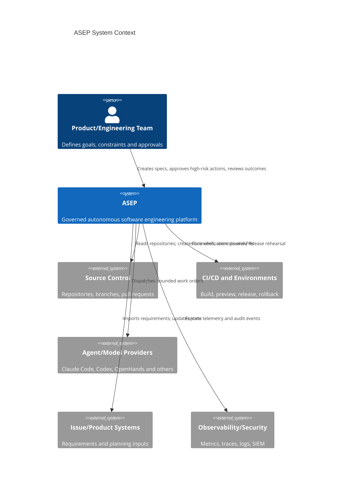
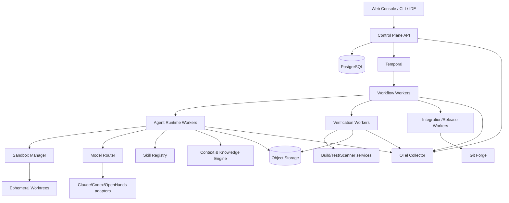

# 1. System Overview

## Problem statement

Long-running coding agents fail when the transcript becomes the project manager, the memory store, the source of truth and the approval system at the same time. Context compaction loses detail; tools fail; workers restart; models change; multiple agents make incompatible assumptions; tests can be incomplete; a persuasive agent can declare success without product evidence.

ASEP separates those responsibilities.

## C4 Level 1 — System context

## C4 Level 2 — Containers

## Core invariants

1. A run can be reconstructed without model transcripts.
2. Every accepted commit has a ProductSpec, WorkOrder, Attempt, VerificationResult and ReviewReport according to risk.
3. A model cannot write outside an isolated workspace or acquire permissions through prompt content.
4. One worktree has one writer lease.
5. Machine-readable raw evidence is captured before any output compression.
6. An experimental adapter cannot become critical-path by configuration accident.
7. Brownfield modules receive autonomy independently; repository-level autonomy is not assumed.
8. The same model may implement and self-review, but independent approval requires fresh context and policy-defined independence.

## Why two orchestration layers

- **Temporal/business orchestration:** survives days, crashes, approvals, retries and deployments.
- **Agent-session orchestration:** bounded reasoning, tools, subagents and context within a single activity/attempt.

ADK, LangGraph, DeerFlow or OpenHands may implement the second layer. They do not own canonical Run/Milestone state.
