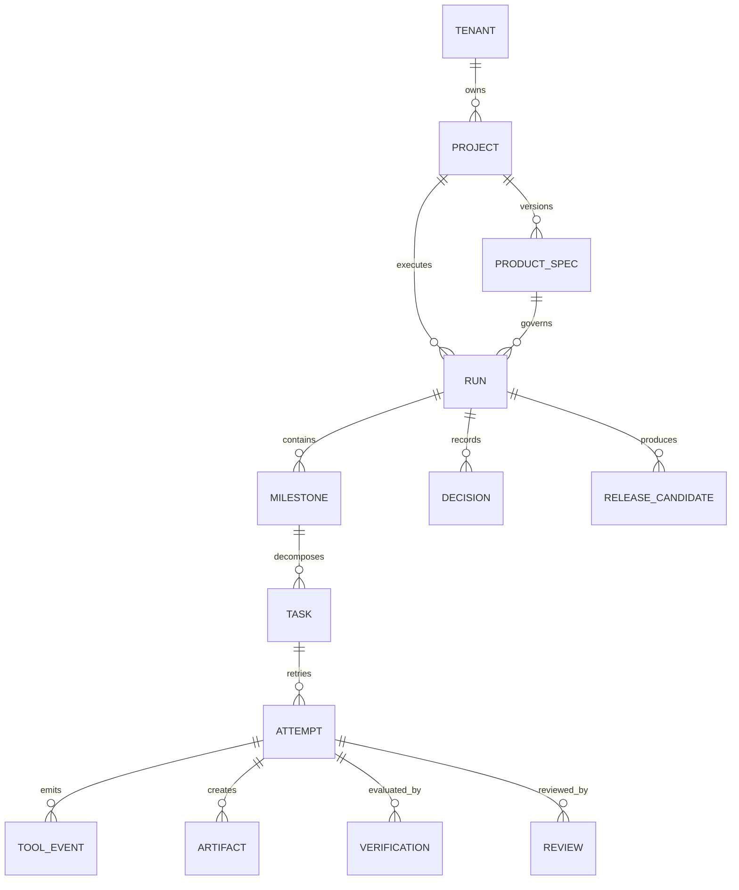

# 3. Domain Model

## Aggregate roots

### Project
- `project_id`, tenant, repository, default branch.
- governance profile, autonomy map, architecture constitution.
- model/tool/skill policies.

### ProductSpec
- immutable version after approval.
- requirement and acceptance IDs remain stable across revisions.
- changes create a new version and impact analysis.

### Run
- one governed delivery initiative against a pinned base SHA and spec version.
- owns milestones, total budget and harness/model policy versions.

### Milestone
- coherent product capability or migration checkpoint.
- dependency edges form a DAG.

### Task/WorkOrder
- smallest independently verifiable unit.
- explicit scope, risk, acceptance checks and budget.

### Attempt
- one provider execution against one immutable ContextPack and workspace.
- retries create new attempts; attempts are never overwritten.

### Verification
- result of a versioned VerificationPlan.
- raw evidence is immutable.

### Review
- independent judgment over spec, diff and evidence.
- findings have identity and lifecycle: OPEN, ACCEPTED, REFUTED, FIXED, WAIVED.

### ReleaseCandidate
- ordered set of accepted task SHAs, environment manifest and release evidence.

## Entity relationship



## Event sourcing boundary

Temporal history is authoritative for workflow progress. A separate append-only Run Ledger records domain/audit events for analytics and cross-system reconstruction. Query tables are projections and may be rebuilt.

## Idempotency

External side effects use:

```text
{tenant}:{run}:{task}:{activity}:{semantic-operation-version}
```

Examples: opening/updating a PR, posting a review, publishing an artifact, creating a preview environment and tagging a release. Activities must distinguish retry from a new business action.
