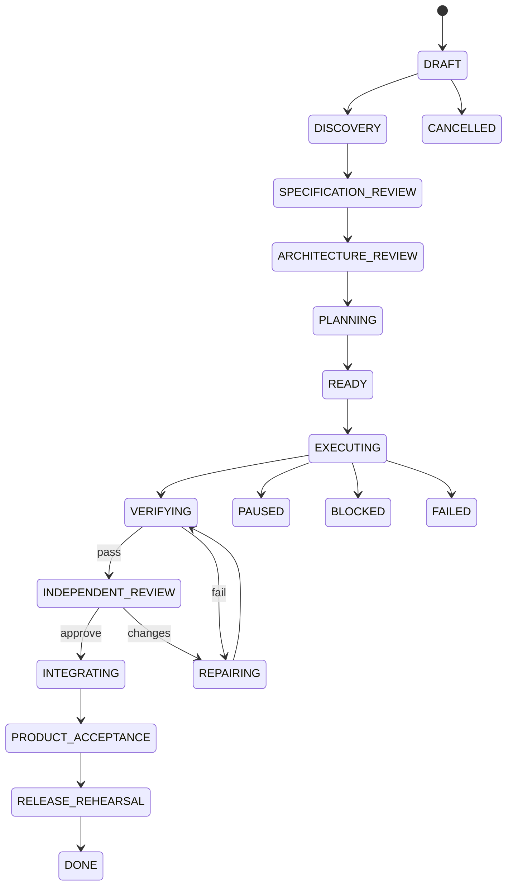

# 4. State Machines

## Run state



## Task state

```text
PROPOSED → READY → LEASED → EXECUTING → EVIDENCE_PENDING
→ VERIFYING → REVIEWING → ACCEPTED → INTEGRATED
```

Failure/side branches: `BLOCKED`, `REPAIR_REQUIRED`, `INVALIDATED`, `BUDGET_EXHAUSTED`, `CANCELLED`.

A downstream task is invalidated when an upstream contract, schema or architecture decision changes beyond its compatibility envelope.

## Finding lifecycle

```text
OPEN → ACKNOWLEDGED → FIXED → VERIFIED → CLOSED
                  ↘ REFUTED → ADJUDICATED
                  ↘ WAIVED (human + expiry + rationale)
```

A model cannot waive HIGH/CRITICAL findings. Waivers expire and are linked to risk acceptance owners.
