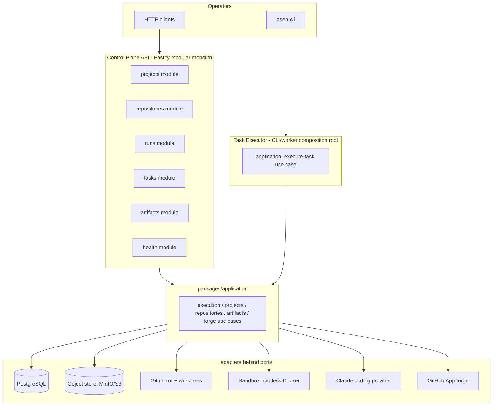
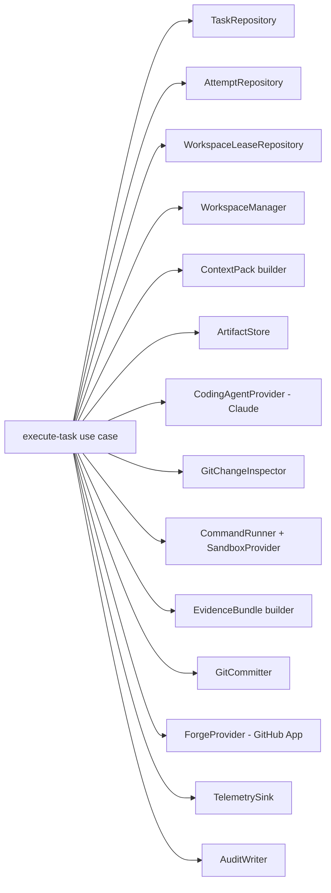

# Phase 2 — Architecture (v1, DRAFT)

> Companion to `phase-02-plan-v1.md`. Base `e046885`. Draft for Codex plan review.

## 1. Thesis (unchanged from Phase 1 ADRs)

Git, PostgreSQL and immutable artifacts are authoritative; model memory is not. Every framework sits behind a port; no provider SDK enters domain/application code. One writer owns a worktree. An agent cannot approve, commit, push or merge its own work — in Phase 2 the terminal machine state is `WAITING_FOR_HUMAN_REVIEW`.

## 2. C4 — Container view (Phase 2 delta)



Long-running execution never runs inside a Control Plane HTTP request. The API registers/validates/queries; the executor (CLI/worker) runs the use case.

## 3. C4 — Component view (Task Executor)



All arrows are ports. The use case has no direct dependency on `pg`, Fastify, Octokit, the Claude SDK, the AWS SDK or Docker.

## 4. Layering rules (fitness-enforced, S1)

```text
apps/*, workers/*        compose application + adapters (composition roots only)
packages/application     → domain, contracts, ports, policy, observability
packages/ports           → domain, contracts
packages/domain          → contracts
packages/contracts       → (leaf)
adapters/*               → ports (+ own provider SDK)
packages/testing         → contracts, ports (fakes)
```

Forbidden imports (extends `scripts/forbidden-imports.test.ts` with mutation self-check):

| Symbol | Allowed only in |
|---|---|
| `fastify` | `apps/control-plane-api`, `adapters/*` transport (if any) |
| `pg` | `adapters/postgres` |
| `@octokit/*` | `adapters/github-app` |
| `@aws-sdk/client-s3` | `adapters/artifact-s3` |
| `@anthropic-ai/claude-agent-sdk` / Claude CLI | `adapters/agent-claude` |
| provider/model SDK types | never in domain/application/contracts/persisted records |
| `node:http(s)`, `node:net` | never in domain/application |

## 5. Trust boundary map

```text
UNTRUSTED                          TRUSTED (harness)
Claude agent process               execute-task use case
  - writes leased worktree only      - owns lease, worktree, commit, push, PR
  - structured events out            - runs verification (approved commands only)
  - NO forge cred                    - holds GitHub App key (JIT installation token)
  - NO network beyond profile        - content-addresses + verifies artifacts
  - NO .git write                    - classifies failure, audits, sets HUMAN_REVIEW
```

Verification commands originate from approved project config + VerificationPlan mapping. A model-generated string never reaches a shell.

## 6. New port signatures (design intent — final shapes decided in S1)

```typescript
// operational routing (separate from business WorkOrder)
interface ExecutionEnvelope {
  readonly organizationId: OrganizationId;
  readonly projectId: ProjectId;
  readonly repositoryBindingId: RepositoryBindingId;
  readonly runId: RunId;
  readonly taskId: TaskId;
  readonly attemptId: AttemptId;
  readonly workOrderRef: ArtifactRef;
  readonly workOrderSchemaVersion: string;
  readonly envelopeSchemaVersion: string;
}

interface ArtifactRef { readonly artifactId: ArtifactId; readonly sha256: string; readonly kind: string; }

interface ArtifactStore {
  put(input: ArtifactPutInput): Promise<ArtifactRef>;          // content-addressed
  get(ref: ArtifactRef): Promise<ArtifactStream>;
  verify(ref: ArtifactRef): Promise<ArtifactVerification>;     // re-hash, fail closed
}

interface WorkspaceLeaseRepository {
  acquire(input: { repositoryBindingId; branch; attemptId; ttlMs }): Promise<Lease | LeaseDenied>;
  heartbeat(leaseId): Promise<void>;
  release(leaseId): Promise<void>;
}

interface WorkspaceManager {
  create(input: { repositoryBindingId; baseSha; leaseId }): Promise<Workspace>;   // pinned baseSha, containment-checked path
  cleanup(workspaceId): Promise<void>;                                            // idempotent
  quarantine(workspaceId, reason): Promise<void>;
}

interface GitChangeInspector {
  inspect(workspace): Promise<{ headSha; changedFiles; createdRefs; touchedGitDir; diff: ArtifactRef }>;
}

interface GitCommitter {
  commit(input: { workspace; allowedPaths; trailers: Record<string,string>; identity }): Promise<{ commitSha }>;
}

interface CommandRunner {                                    // shell:false, execFile/spawn
  run(spec: CommandSpec, sandbox: SandboxHandle): Promise<CommandResult>;  // exact exit/signal, raw artifacts
}

interface CommandSpec {
  readonly executable: string;
  readonly args: readonly string[];
  readonly cwd: WorkspaceRelativePath;
  readonly environmentProfile: string;
  readonly timeoutMs: number;
  readonly outputPolicy: OutputPolicy;
}

interface SandboxProvider {
  start(profile: 'verification-no-network' | 'agent-restricted-egress', mount: WorkspaceMount): Promise<SandboxHandle>;
  stop(handle): Promise<void>;
}

interface ForgeProvider {
  pushBranch(input: { repositoryBindingId; branch; commitSha }): Promise<void>;
  upsertPullRequest(input: { repositoryBindingId; headBranch; base; title; body }): Promise<PullRequestRef>;  // idempotent, no merge
}

interface GitHubAppCredentialProvider {
  installationToken(input: { installationId; repositoryId; permissions }): Promise<OpaqueToken>;  // JIT, scoped, opaque
}
```

## 7. Sandbox profiles

`verification-no-network`: rootless Docker, `--network none`, read-only root fs, writable workspace mount only, tmpfs `/tmp`, memory/CPU/PID limits, dropped capabilities, `--security-opt no-new-privileges`, default seccomp, no Docker socket, image pinned by digest.

`agent-restricted-egress`: proxy allowlist or explicitly documented pilot-only. Never presented as a production sandbox if the host cannot enforce it.

## 8. Data authority & idempotency

PostgreSQL is authoritative for operational state; object store for artifact bytes; Git for code + harness commits. Every side effect carries an idempotency key so a retried executor run detects the prior result. Content-addressed artifacts are naturally idempotent. Attempt→commit and attempt→PR are 1:1.

## 9. Phase 3 seam

`execute-task` is a pure orchestration function over injected ports with serializable inputs and explicit idempotency — a Temporal activity can wrap it unchanged. No durable-engine, HTTP or Fastify import leaks into `packages/application`. `WorkflowEngine` (already in `packages/ports`) is the future dispatch seam; Phase 2 dispatches via CLI/worker instead, proving the same use case runs without Temporal.
