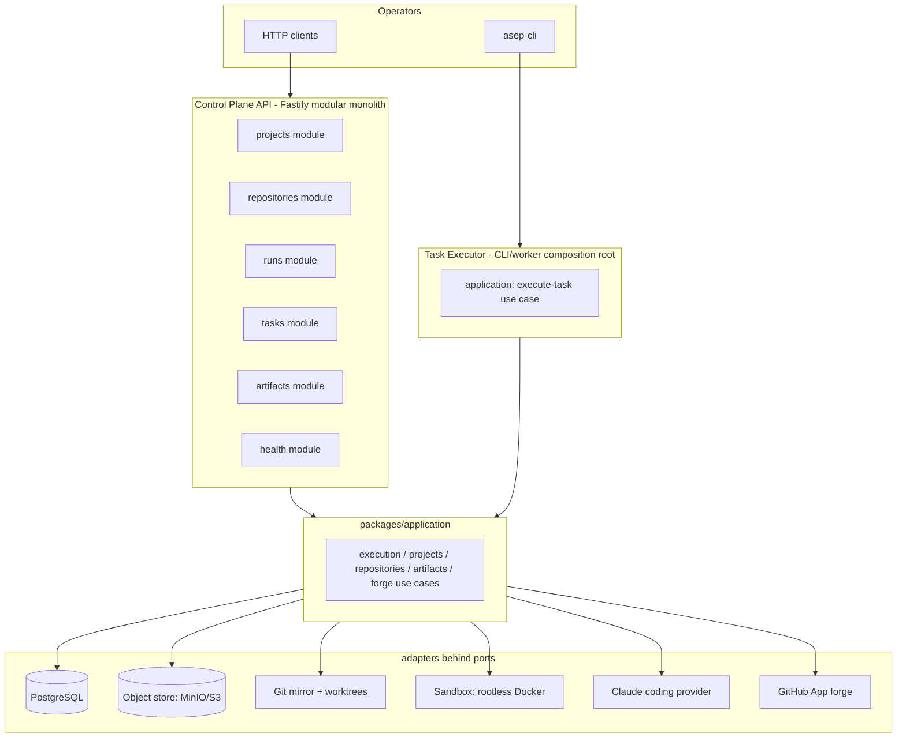
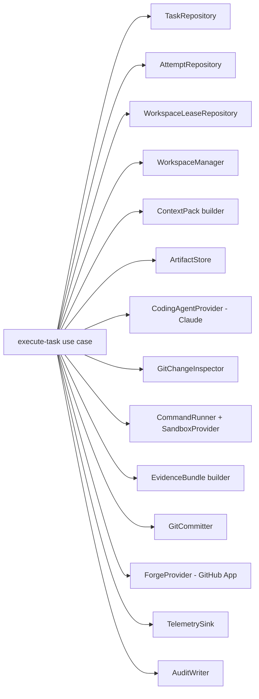

# Phase 2 — Architecture (LOCKED)

> Companion to `phase-02-plan.md`. Base `e046885`. Locked after Codex plan review (`REQUEST_CHANGES` @ 0.98) + disposition in `phase-02-review-log.md`. All accepted findings folded here.

## 1. Thesis (unchanged from Phase 1 ADRs)

Git, PostgreSQL and immutable artifacts are authoritative; model memory is not. Every framework sits behind a port; no provider SDK enters domain/application code. One writer owns a worktree. An agent cannot approve, commit, push or merge its own work — in Phase 2 the terminal machine state is `WAITING_FOR_HUMAN_REVIEW`.

## 2. C4 — Container view (Phase 2 delta)



Long-running execution never runs inside a Control Plane HTTP request. The API registers/validates/queries; the executor (CLI/worker) runs the use case.

## 3. C4 — Component view (Task Executor)



All arrows are ports. The use case has no direct dependency on `pg`, Fastify, Octokit, the Claude SDK, the AWS SDK or Docker.

## 4. Layering rules (fitness-enforced, S1)

**"Composition-root only" defined (disp. P2-PLAN-LOW-001).** Handlers in `apps/*` and `workers/*` may do transport parsing, authentication hooks, request validation and response mapping. They may **not** contain domain decisions, persistence queries, provider calls or workflow sequencing. The architecture fitness test uses a seeded-mutation self-check: a planted policy/SQL/Git/provider call in a handler must fail the test, while a thin route mapping an authenticated request to an application use case must pass.

```text
apps/*, workers/*        compose application + adapters (composition roots only)
packages/application     → domain, contracts, ports, policy, observability
packages/ports           → domain, contracts
packages/domain          → contracts
packages/contracts       → (leaf)
adapters/*               → ports (+ own provider SDK)
packages/testing         → contracts, ports (fakes)
```

Forbidden imports (extends `scripts/forbidden-imports.test.ts` with mutation self-check):

| Symbol | Allowed only in |
|---|---|
| `fastify` | `apps/control-plane-api`, `adapters/*` transport (if any) |
| `pg` | `adapters/postgres` |
| `@octokit/*` | `adapters/github-app` |
| `@aws-sdk/client-s3` | `adapters/artifact-s3` |
| `@anthropic-ai/claude-agent-sdk` / Claude CLI | `adapters/agent-claude` |
| provider/model SDK types | never in domain/application/contracts/persisted records |
| `node:http(s)`, `node:net` | never in domain/application |

## 5. Trust boundary map

```text
UNTRUSTED                          TRUSTED (harness)
Claude agent process               execute-task use case
  - writes leased worktree only      - owns lease, worktree, commit, push, PR
  - structured events out            - runs verification (approved commands only)
  - NO forge cred                    - holds GitHub App key (JIT installation token)
  - NO network beyond profile        - content-addresses + verifies artifacts
  - NO .git write                    - classifies failure, audits, sets HUMAN_REVIEW
```

Verification commands originate from approved project config + VerificationPlan mapping. A model-generated string never reaches a shell.

**OS-enforced agent/Git separation (disp. P2-PLAN-HIGH-006).** "NO `.git` write" is a hard OS boundary, not post-hoc detection. The untrusted Claude agent runs in a **separate sandboxed process** (never in the harness process) with only the intended worktree working-tree files writable. The linked-worktree `.git` indirection file, the shared mirror, refs, objects, config and hooks are mounted **read-only or omitted**; safe Git observations are exposed through trusted tooling (`GitChangeInspector`) after the agent exits. Post-execution inspection is a second line, not the boundary — a malicious attempt must be unable to corrupt the mirror in the first place. OS-level tests from inside the agent sandbox must fail writes to `.git`/refs/objects/config/hooks/mirror, and host snapshots must remain byte-identical after corruption attempts, exercised through the real Claude adapter boundary.

## 6. New port signatures (design intent — final shapes decided in S1)

```typescript
// operational routing (separate from business WorkOrder)
interface ExecutionEnvelope {
  readonly organizationId: OrganizationId;
  readonly projectId: ProjectId;
  readonly repositoryBindingId: RepositoryBindingId;
  readonly runId: RunId;
  readonly taskId: TaskId;
  readonly attemptId: AttemptId;
  readonly workOrderRef: ArtifactRef;
  readonly workOrderSchemaVersion: string;
  readonly envelopeSchemaVersion: string;
}

interface ArtifactRef { readonly artifactId: ArtifactId; readonly sha256: string; readonly kind: string; }

// disp. P2-PLAN-HIGH-002: CodingAgentProvider is REDESIGNED (not reused as-is).
// Request carries harness-owned identity + request-scoped workspace/cancellation;
// result is UNTRUSTED self-report only. Git state/changed-files/resultSha are
// derived by trusted GitChangeInspector/GitCommitter, never returned by the provider.
interface AgentExecuteRequest {
  readonly attemptId: AttemptId;            // harness-owned, pre-created
  readonly workOrderRef: ArtifactRef;       // immutable + hash
  readonly contextPackRef: ArtifactRef;     // immutable + hash
  readonly workspace: WorkspaceCapability;  // opaque handle; no raw path
  readonly budget: Budget;
  readonly toolPolicy: ToolPolicyProfile;   // allowed/disallowed tools + network profile
  readonly signal: AbortSignal;             // request-scoped cancellation
}
interface AgentAttemptObservation {         // UNTRUSTED
  readonly status: 'AGENT_DONE'|'FAILED'|'BLOCKED'|'BUDGET_EXHAUSTED';
  readonly summary: string;
  readonly knownLimitations: readonly string[];
  readonly providerSessionId?: string;
  readonly usage: Usage;
  readonly eventArtifactRefs: readonly ArtifactRef[];   // no attemptId/resultSha/changedFiles
}
interface CodingAgentProvider {
  readonly providerId: string;
  execute(req: AgentExecuteRequest): Promise<AgentAttemptObservation>;
}

interface ArtifactStore {
  put(input: ArtifactPutInput): Promise<ArtifactRef>;          // content-addressed
  get(ref: ArtifactRef): Promise<ArtifactStream>;
  verify(ref: ArtifactRef): Promise<ArtifactVerification>;     // re-hash, fail closed
}

interface WorkspaceLeaseRepository {
  acquire(input: { repositoryBindingId; branch; attemptId; ttlMs }): Promise<Lease | LeaseDenied>;
  heartbeat(leaseId): Promise<void>;
  release(leaseId): Promise<void>;
}

interface WorkspaceManager {
  create(input: { repositoryBindingId; baseSha; leaseId }): Promise<Workspace>;   // pinned baseSha, containment-checked path
  cleanup(workspaceId): Promise<void>;                                            // idempotent
  quarantine(workspaceId, reason): Promise<void>;
}

interface GitChangeInspector {
  inspect(workspace): Promise<{ headSha; changedFiles; createdRefs; touchedGitDir; diff: ArtifactRef }>;
}

interface GitCommitter {
  commit(input: { workspace; allowedPaths; trailers: Record<string,string>; identity }): Promise<{ commitSha }>;
}

interface CommandRunner {                                    // shell:false, execFile/spawn
  run(spec: CommandSpec, sandbox: SandboxHandle): Promise<CommandResult>;  // exact exit/signal, raw artifacts
}

interface CommandSpec {
  readonly executable: string;
  readonly args: readonly string[];
  readonly cwd: WorkspaceRelativePath;
  readonly environmentProfile: string;
  readonly timeoutMs: number;
  readonly outputPolicy: OutputPolicy;
}

// disp. P2-PLAN-MED-002: bounded streaming capture; display limit ≠ evidence retention.
interface OutputPolicy {
  readonly maxEvidenceBytes: number;      // hard cap; overflow → explicit truncation marker + fail-closed on required checks
  readonly displayHeadBytes: number;      // bounded context summary only
  readonly displayTailBytes: number;
}
interface CommandResult {
  readonly exitCode: number | null;       // exact; never coerced
  readonly signal: string | null;
  readonly timedOut: boolean;
  readonly stdout: ArtifactRef;           // full raw bytes streamed to immutable artifact BEFORE any summary
  readonly stderr: ArtifactRef;
  readonly stdoutBytes: number; readonly stderrBytes: number;
  readonly truncated: boolean;
}

interface SandboxProvider {
  start(profile: 'verification-no-network' | 'agent-restricted-egress', mount: WorkspaceMount): Promise<SandboxHandle>;
  stop(handle): Promise<void>;
}

// disp. P2-PLAN-CRIT-001: refspec safety is non-bypassable and lives in the forge adapter.
interface ForgeProvider {
  pushBranch(input: { repositoryBindingId; branch; commitSha; expectedRemoteSha?: string }): Promise<void>;
  upsertPullRequest(input: { repositoryBindingId; headBranch; base; title; body }): Promise<PullRequestRef>;  // idempotent, NO merge method
}
// RefSafetyPolicy (enforced inside pushBranch, cannot be bypassed):
//   - branch MUST be under the ASEP-owned namespace (e.g. asep/<runId>/<taskId>/<attemptId>)
//   - reject head == configured default/protected ref (main/master/HEAD/tags)
//   - validate with git check-ref-format; reject option-like/malformed/newline
//   - allow ONLY an exact create/update refspec; prohibit delete and force
//     (force-with-lease only against a recorded expectedRemoteSha)
//   - pilot repo MUST carry a ruleset denying direct default-branch writes + App merges
// GitHubAppCredentialProvider is NOT an application port (disp. P2-PLAN-MED-008): token
// minting is internal to adapters/github-app; application code sees only ForgeProvider.
// Tokens are opaque values paired with provider-reported expiry, minted JIT per bounded
// operation, never persisted; auth-expiry re-mints and reconciles by natural key without
// replaying a completed side effect (disp. P2-PLAN-MED-005).
```

## 7. Sandbox profiles

`verification-no-network`: rootless Docker, `--network none`, read-only root fs, writable workspace mount only, tmpfs `/tmp`, memory/CPU/PID limits, dropped capabilities, `--security-opt no-new-privileges`, default seccomp, no Docker socket, image pinned by digest.

`agent-restricted-egress`: proxy allowlist or explicitly documented pilot-only. Never presented as a production sandbox if the host cannot enforce it.

## 8. Data authority & idempotency

PostgreSQL is authoritative for operational state; object store for artifact bytes; Git for code + harness commits. Every side effect carries an idempotency key so a retried executor run detects the prior result. Content-addressed artifacts are naturally idempotent. Attempt→commit and attempt→PR are 1:1.

**Crash-safe side effects (disp. P2-PLAN-HIGH-005).** An `idempotency_records` row cannot atomically cover an external Git/GitHub call. Each external side effect (commit, exact-ref push, PR upsert) is a `PENDING → COMPLETED | FAILED` record with a tenant-scoped semantic key, a request fingerprint, and an owner/fencing token. On restart the executor reconciles by natural key — one commit, one expected remote ref, one PR — distinguishing a retry (same fingerprint → adopt prior outcome) from a new business attempt (different fingerprint → reject reuse). See `phase-02-data-model.md` §3 idempotency_records. This is the operational-projection authority; **it is not a second workflow orchestrator** — it records step outcomes, it does not schedule.

## 9. Phase 3 seam

`execute-task` is composed of **framework-free, individually idempotent step use cases** (acquire-lease, create-worktree, build-context, invoke-agent, inspect, verify, build-evidence, commit, push, upsert-PR), driven in Phase 2 by a thin sequential driver (disp. P2-PLAN-MED-003). Each step is separately resumable from its persisted record, so Phase 3 can compose the same step APIs as Temporal activities with activity-level retry/heartbeat/cancellation — without duplicating workflow ownership. A second thin test driver resumes from each persisted step, and a Temporal-shaped fake workflow composes the same step APIs, proving the seam. No durable-engine, HTTP or Fastify import leaks into `packages/application`. `WorkflowEngine` (already in `packages/ports`) is the future dispatch seam; Phase 2 dispatches via CLI/worker, proving the same steps run without Temporal.
