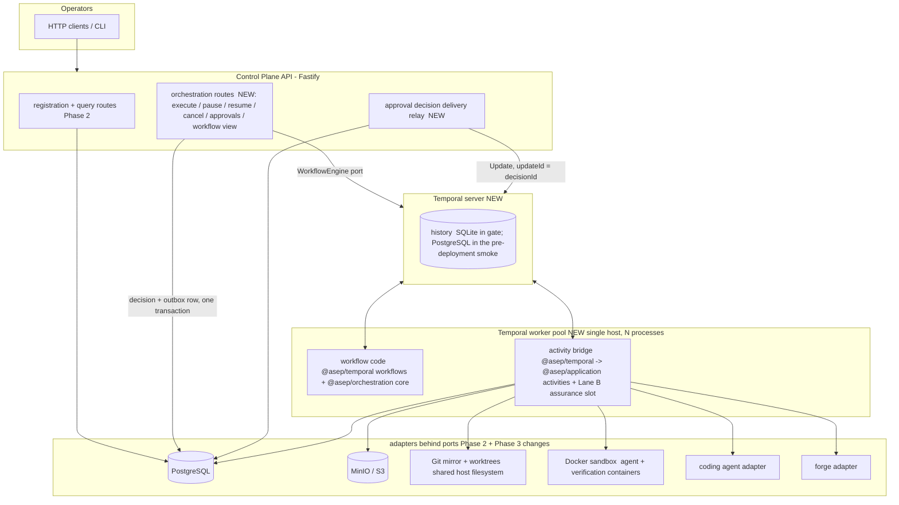

# Phase 3 — Durable Orchestration — Architecture (LOCKED v5, pending controller confirmation)

> Companion to `phase-03-plan.md`. Base `00a6889` (head of `phase/02-single-agent-vertical-slice`, not yet
> accepted); v1 of this document is at `80bb76a`, v2 at `98e92cf`, v3 at `7cbf5d3` (R20 at `e4fd343`). v2 folded in
> the Codex plan review; v3 folds in the Codex lock-check of v2 (`phase-03-plan-review-codex-v2.md`) and the
> controller's reconciliation R15–R20 (`phase-03-review-log.md`, section "Lock-check v2"); v4 folds in the Codex
> review of v3 and audit of S2 (`phase-03-review-codex-v3.md`) and reconciliation R21 (review log, section
> "Review v3"); v5 folds in the Codex re-audit of v4 and of the S2 fixes (`phase-03-review-codex-v4.md`) and
> reconciliation R24 (section "Review v4"). Port signatures in §17 are design intent. The binding text
> is plan §30 (shared-surface change requests) and, for the review-loop slot, the block
> `Review-loop slot contract (verbatim for S0)` that Lane B locks and the controller hands over (plan §30, CR-10).

## 1. Thesis and authority split

ADR 0001 assigns run/milestone/task durability, retries, timers, approvals and recovery to Temporal. ADR 0013
allows exactly one durable orchestrator. Phase 3 makes both concrete:

| Concern | Authority after Phase 3 | Not authoritative |
|---|---|---|
| What step runs next, retries, timers, pause, cancel, approval waits, budget decisions, assurance-outcome routing | **Temporal workflow history** | PostgreSQL rows, worker memory |
| Tenancy, run/task/attempt identity, leases, side-effect records, approvals evidence, budget ledger, audit, run events | **PostgreSQL** (operational state and projection) | Temporal search attributes or memo |
| Artifact bytes | Object store (content-addressed) | — |
| Code and harness commits | Git (mirror + remote) | — |

The rule that keeps PostgreSQL from becoming a second orchestrator: **no activity reads a projected status
column to decide what the workflow does next.** Activities read PostgreSQL only for idempotency (natural keys,
side-effect records), fencing (the Phase 2 lease-bound primitive), scope checks and evidence (approval
decisions). Sequencing decisions live only in workflow code. Chaos test F13 tampers with `tasks.status` mid-run
and proves the workflow ignores it and the projection self-corrects.

The Phase 2 sequential driver (`runVerticalSliceWorkflow`, `packages/application/src/vertical-slice-workflow.ts:273`)
stays in the tree **only as a test driver** for the step use cases, which is how Phase 2's K1 proofs run. No
production entrypoint may reach it after S9 (fitness rule, exit B8).

**Dependency on the Phase 2 repair (cycle 7).** Three Phase 2 deliverables are foundations here, not things
Lane A designs: the lease-bound fenced takeover (Phase 2 HIGH-006), the typed side-effect result binding
(HIGH-005), and the real agent runtime (HIGH-008). Until Phase 2 is accepted, this document states what Lane A
needs from them as **invariants** (§7), not as signatures (R1). Slices that build on them wait for the rebase
(plan §25).

## 2. C4 — Container view (Phase 3 delta)



Long-running work never runs inside an HTTP request. That is unchanged from Phase 2. The API only starts
workflows, sends control messages, records approval decisions and queries.

## 3. Packages and layering (fitness-enforced)

```text
packages/orchestration   NEW  pure, deterministic workflow decision core
                              production source (src/**, excluding *.test.ts and src/test-support/**):
                              -> import type only from @asep/contracts, @asep/ports
                              -> runtime imports only between its own modules (relative)
                              -> NO external runtime dependency; NO node:*, Date, Math.random, timers
                              tests and test support may use node:test, node:assert/strict and the module under test
packages/application     EXTENDED  src/orchestration-activities/** (retry-safe activity implementations)
                              -> domain, contracts, ports, policy, observability (unchanged rule)
adapters/temporal        NEW  the ONLY package that imports @temporalio/*
  src/workflows/**            -> @temporalio/workflow + @asep/orchestration only
  src/activity-bridge/**      -> @temporalio/activity + @asep/ports types (wraps application activities)
  src/client/**               -> @temporalio/client (implements WorkflowEngine port)
  src/worker/**               -> @temporalio/worker (bundling, Worker.create factory)
workers/temporal-worker  NEW  composition root: build adapters + bind the assurance slot -> createWorker(); no sequencing
apps/control-plane-api   EXTENDED  src/orchestration/** routes + delivery relay; production-root wires WorkflowEngine
```

Lane B's assurance code (`packages/application/src/assurance/**`) is framework-free and imports nothing Lane A
adds. Lane A's worker composition root imports Lane B's `assurance-root.ts` at integration time and binds it
into the activity bridge (R10).

Forbidden-import rules added (CR-12). They are written against the rule framework the accepted Phase 2 lands
(an AST-based check replaces today's regex guard, R8), each with a seeded-violation self-check:

| Rule | Scope | Detects |
|---|---|---|
| `@temporalio/*` confined | every package except `adapters/temporal` (its `src/test-support/**` included) | any import or require of `@temporalio/` |
| workflow purity | `adapters/temporal/src/workflows/**` | any non-type import except `@temporalio/workflow`, `@asep/orchestration` and relative workflow modules |
| core purity | production source of `packages/orchestration` (`src/**/*.ts` except `*.test.ts` and `src/test-support/**`) | checked with the TypeScript checker (R24): a non-relative import or re-export that is not `import type`/`export type` from `@asep/contracts` or `@asep/ports` (import-equals and import types included); a relative import, re-export or import type whose specifier holds a percent-encoded character, a query or a fragment, does not end in `.js`, or does not resolve, through the compiler's module resolution, to a `.ts` file of the scanned production set (so no target outside `src/`, in `src/test-support/**`, in a test file or in a non-`.ts` module); dynamic `import()`; the identifiers `Date`, `setTimeout`, `setInterval`, `setImmediate`, `queueMicrotask`, `performance`, `process`, `crypto`, `require`, `globalThis`, `WeakRef`, `FinalizationRegistry`, `eval`, `Function`, `Reflect`, `Proxy`, `fetch`; any `constructor`, `prototype` or `__proto__` member, as an identifier or a literal key; a computed member access whose key type is not a finite union of literals, or whose literal key names a denied identifier, a denied member or `Math`; `Math` other than `Math.<member>` for `abs`, `ceil`, `floor`, `imul`, `max`, `min`, `round`, `sign`, `trunc` |
| bundler truth | `adapters/temporal` | real `bundleWorkflowCode()` with no `ignoreModules` succeeds. A seeded `node:fs` workflow fixture fails. |
| no second driver | production entrypoints (`server-main`, `pilot-main`, `cli-main`, `workers/temporal-worker/src/main.ts`) | the import graph reaches `runVerticalSliceWorkflow`, `runVerticalSlice`, `governedExecution`, `completeToReview` or `executeTask` |
| activity options explicit | `adapters/temporal/src/workflows/**` | a `proxyActivities` option set without `retry.maximumAttempts`, `startToCloseTimeout` or (for long activities) `heartbeatTimeout` (unit test over the exported option table) |
| application stays engine-free | `packages/application/src/**` | `@temporalio/*` |
| no fault injection in production | production entrypoints | the import graph reaches `FaultInjector` (exit B9) |

The core-purity rule has two acceptance checkpoints (P3-PLAN2-MED-001, MED-002):

1. **S2, before G-P2.** A self-contained purity check inside the package (`packages/orchestration/src/purity.test.ts`,
   `asep-suite:orchestration-purity`). It does not touch the shared rule framework. It scans production source
   only, carries seeded violations for each rule, and has self-checks that a valid construct passes and that
   the production file set excludes tests and test support. It asks the TypeScript checker (R24, as the Phase 2
   fitness guard does): it loads the package's own project with the TypeScript compiler API the repo already
   depends on (TypeScript 7.0.2 `typescript/unstable/sync`, research register Q11), with seeded files overlaid in
   memory. It reads type-only status from each import clause and specifier, resolves every relative import with the
   compiler's module resolution and requires the target to be a production file of the scan, reads the type of
   every computed member key, and matches denied names on the decoded identifier, so comments, string text,
   aliases, escapes, reflection and computed keys neither hide nor fake a use. It asserts that every production
   file parsed. **The detector is a defence layer, not a proof:** a value built at run time from arbitrary
   computation can still evade a static check. It closes the shapes that are cheap to write by accident or on
   purpose; the bundler-truth rule above and the replay corpus (§6.5) stay the checks of what the workflow really
   loads and does.
2. **S7, after G-P2.** The same rule is written into `scripts/forbidden-imports.test.ts` on the accepted Phase 2
   framework, with its own seeded violation. The package-local suite stays registered afterwards, because
   `REQUIRED_SUITES` is append-only (R10), so the rule is enforced at every commit and both checks must pass.

## 4. Workflows

### 4.1 `taskWorkflow` (one per Task; workflow ID `asep-task-<taskId>`)

The deterministic core (`@asep/orchestration`) is a reducer `decide(state, event) -> { state, commands }`. The
Temporal workflow is a thin interpreter: it turns commands into activity calls and timers, and feeds activity
results, timer firings and messages back as events. The same reducer is driven by an in-memory sequential test
driver in S2, so the decision logic is proven without Temporal and then reused unchanged.

```text
ADMITTING (admitTask: injected admit hook, default admitRisk) ──(DEFERRED)──▶ BLOCKED (terminal)
   │ admitted            admitTask activity fails ──▶ BLOCKED (reason admission-unavailable)
   ▼
BUDGET_CHECK (reservation for the planned attempt; table "Reservation failure" in §10)
   │ reserved           ──(maxAttempts exhausted)──▶ FAILED (attempts-exhausted; repair-capacity-exhausted for
   │                                                  a repair lineage)
   │                    ──(task cap short, maxBudgetExtensionUsd set)──▶ AWAITING_APPROVAL(budget-extension)
   │                                                  approve → BUDGET_CHECK (same attempt plan and lineage)
   │                                                  reject/expiry → BUDGET_EXHAUSTED (terminal)
   │                    ──(any other budget cause, or maxBudgetExtensionUsd unset)──▶ BUDGET_EXHAUSTED (terminal)
   ▼
ATTEMPT_STARTING  (ensureAttempt → acquireLease → prepareWorkspace(base = task baseSha, or the lineage's
                   repairBaseSha) → storeAttemptInputs (repair lineage: ContextPack = buildRepairContextPack(...)))
                   ensureAttempt fails ──▶ findAttempt (lookup by (task_id, attempt_number); R21):
                     found  → the attempt ends `failed` with zero usage
                     absent → no attempt-bound effect (usage, outcome) at all
                     lookup fails → no attempt-bound effect; audited attempt.registration-unreconciled
                   ──▶ FAILED (attempt-registration-failed; never replaced, numbering stays contiguous)
   ▼
AGENT_RUNNING  (runAgent: engine maximumAttempts = 1; heartbeats; lease renewed on each tick)
   │ outcome table "Agent outcome" in §10 (the first matching row wins):
   │   AGENT_DONE within every cap (cost, tool calls,
   │   harness-measured wall-clock up to cap + kill grace) ──▶ INSPECTING → VERIFYING → … (full path)
   │   a failure class that is not replaceable
   │   (FAILED, BLOCKED or a cap stop reporting one),
   │   overrun or not                                  ──▶ ATTEMPT_ABANDONED → FAILED with that class
   │                                                       (an overrun is still recorded and audited)
   │   BUDGET_EXHAUSTED (adapter stopped at a cap),
   │   or usage above a cap (cost, tool calls, or
   │   wall-clock beyond cap + kill grace: overrun)    ──▶ INSPECTING only → ATTEMPT_EXHAUSTED
   │   FAILED / BLOCKED (replaceable failure class)    ──▶ ATTEMPT_ABANDONED(failure class)
   │   activity failure / heartbeat timeout (infra)    ──▶ ATTEMPT_ABANDONED(failure class)
   ▼
INSPECTING     (inspectWorkspace)        ▶ overstep → ATTEMPT_ABANDONED(policy-violation)
   ▼
VERIFYING      (runVerification; its budget was reserved separately at BUDGET_CHECK)
   ├─ PASS ─────▶ COMMITTING (commitAttempt) ▶ EVIDENCE (persistEvidence)   [critical unit 1] ▶ ASSURANCE_ROUND
   └─ FAIL/ERROR ▶ VERIFICATION_STOP: recordAttemptOutcome('verification-failed') → cleanup → FAILED (terminal)
ASSURANCE_ROUND (assuranceRound activity = Lane B runAssuranceRound; cancellable) — outcome:
   PROCEED  ─▶ PUBLICATION_GATE ─▶ PUBLISHING (PR body carries prBodySectionRef)
               ─▶ recordAttemptOutcome('proceeded') ─▶ REVIEW_HANDOFF
   ESCALATE ─▶ PUBLICATION_GATE ─▶ PUBLISHING (PR flagged "assurance not satisfied", prBodySectionRef)
               ─▶ recordAttemptOutcome('escalated') ─▶ REVIEW_HANDOFF
   REPAIR   ─▶ recordAttemptOutcome('repair-requested') ─▶ BUDGET_CHECK (next attempt: kind repair, with the
               repair lineage base = repairBaseSha, repair order, round = nextRound,
               priorAdjudicationId = adjudicationId)
   BLOCK    ─▶ recordAttemptOutcome('blocked') → reap → quarantine → BLOCKED (terminal); nothing published
   anything else (unknown kind, missing field, REPAIR without repairBaseSha …) ─▶ audited
               review-slot.contract-violation → FAILED (terminal)
   the activity itself fails (retries exhausted or non-retryable) ─▶ audited assurance-unavailable, then
               shadow mode: continue as PROCEED (no section ref); gating mode: continue as ESCALATE. Never FAILED.
PUBLICATION_GATE ──(publicationApprovalRequired)──▶ AWAITING_APPROVAL(publish-change)   [cancellable wait]
   ▼
PUBLISHING  (publishBranch [critical unit 2] → upsertPullRequest [critical unit 3]; every result and failure
             of the two carries the publication effect applied | none | unknown, whatever its retryability, R24)
   │ push applied (a result, or a failure that reports applied) ──▶ upsertPullRequest
   │ push fails with effect none (proved before the forge call) ──▶ FAILED (publication-failed)
   │ push fails with effect unknown                             ──▶ reconcilePublication (read the remote):
   │     branch head = the attempt's commit → upsertPullRequest; branch absent → FAILED (publication-failed);
   │     branch at another commit, or the read fails            → FAILED (publication-incomplete)
   │ PR upsert fails with effect none                           ──▶ FAILED (publication-incomplete)
   │ PR upsert fails with effect unknown or applied             ──▶ reconcilePublication: PR found → as a
   │                                                              successful upsert; PR absent, or the read
   │                                                              fails → FAILED (publication-incomplete)
   │ publication-incomplete is audited publication.incomplete with the remote branch and whether the push was
   │ confirmed, and is never CANCELLED; publication-failed means nothing was pushed, so a pending cancel ends the
   │ task CANCELLED instead.
   ▼
REVIEW_HANDOFF (projectTaskState WAITING_FOR_HUMAN_REVIEW) ─▶ CLEANUP ─▶ done

ATTEMPT_ABANDONED: reapContainers → quarantineWorkspace → releaseLease → recordUsage → recordAttemptOutcome('failed')
   → BUDGET_CHECK (kind = retry, same repair lineage) if the failure class is replaceable, attempts remain and no
   push record exists, else FAILED. Replaceable classes (policy data, `policies/orchestration-policy.yaml`):
   environment, provider, quota-rate-limit, tool, agent-loop-stall, artifact-loss, workflow-recovery-failure.
   Never replaceable: policy-violation, false-completion, duplicate-side-effect (Phase 1 taxonomy,
   `policies/failure-taxonomy.yaml`). This holds whatever the policy says: the core never treats these three as
   replaceable, and the policy loader and the input mapping reject a policy that lists them (R21).
ATTEMPT_EXHAUSTED: reapContainers → quarantineWorkspace → releaseLease → recordUsage (+ recordOverrun and an
   audited overrun incident when usage exceeded a cap) → recordAttemptOutcome('budget-exhausted')
   → BUDGET_CHECK (kind = retry, same repair lineage). Nothing of the attempt is verified, committed or published.
   An inspection that fails on an exhausted attempt is a normal ATTEMPT_ABANDONED (R20).
Any phase + cancel → CANCELLING (finish an open critical unit, and once a push has started also the PR upsert;
   reap, quarantine, release, recordAttemptOutcome('cancelled')) → CANCELLED. Assurance, repair planning and
   approval waits are interrupted at once. A cancel never finalizes while a publication unit is unreconciled: an
   effect reported unknown is reconciled against the remote first, and if the publication cannot reconcile (the PR
   upsert failed, or the reconciliation read failed) the task ends FAILED (publication-incomplete), not CANCELLED
   (R21, R24).
Any phase boundary + pause → PAUSED (lease renewed by timer; pause timeout → recordAttemptOutcome('cancelled')
   → BLOCKED). A pause never splits a critical unit, nor push from its PR upsert. While the task waits for an
   approval no request is in flight, so a pause applies at once: projection PAUSED, pause timer started. The
   approval's expiry timer keeps running (R21).
```

**Verification stops end the task.** A failed or errored mandatory verification is a deterministic result, and
Phase 3 does not retry it with a new agent attempt or route it to an assurance round (R3). Infrastructure
errors are retried **inside** `runVerification` (engine retry, §5), not by a new attempt. This is Phase 2's
behavior, now durable.

**One-PR-per-task invariant.** A replacement attempt (kind `retry` or `repair`) is only ever started when no
`push` side-effect record exists for any earlier attempt of the task. The assurance round runs before
publication. So at most one attempt per task publishes, and the task has at most one remote ref and one PR.
The core enforces this as a guard on the `startAttempt` command, and property tests check it.

**Attempt kind and repair lineage are separate (R17, P3-PLAN2-MED-005).** `kind` says why the attempt exists:
`initial`, `retry` (it replaces an abandoned or exhausted attempt) or `repair` (an assurance `REPAIR`). The
repair lineage says what it builds on: `repairBaseSha`, the repair order, the round, the prior adjudication and
the parent attempt whose harness commit is the base. A `repair` attempt always carries a lineage. A `retry`
copies the lineage of the attempt it replaces, so a retry of a failed repair attempt starts from the same
`repairBaseSha` with the same repair order, round and prior adjudication, and its assurance round continues the
same lineage. An `initial` attempt has none.

**Repair workspace ordering.** The parent attempt's workspace is cleaned only after the workspace of the first
attempt in its lineage is `ACTIVE`. Until then the parent's harness commit stays referenced by a live worktree, so
`repairBaseSha` cannot be pruned from the shared mirror. A replaced lineage attempt is quarantined, not deleted,
so its worktree keeps the base reachable too. `prepareWorkspace` checks the object exists before
`git worktree add` and fails non-retryably otherwise. The parent's lease is released when the `REPAIR` outcome is
routed, because the repair attempt needs the single writer lease for the task branch.

Terminal outcomes and their projected `TaskStatus`: review handoff → `WAITING_FOR_HUMAN_REVIEW` (terminal for
the harness, as in Phase 2, for both `PROCEED` and `ESCALATE`); `FAILED`; `BLOCKED` (deferred risk, admission
unavailable, assurance `BLOCK`, publication rejected, pause timeout); `BUDGET_EXHAUSTED`; `CANCELLED`. No phase leads to `ACCEPTED` or
`DONE` (Phase 2 invariant I2 is preserved). The task stays `VERIFYING` through the assurance and repair rounds.

### 4.2 `runWorkflow` (one per Run; workflow ID `asep-run-<runId>`)

- Accepts `submitTask` Updates (update ID = `submit-<taskId>`, plus a workflow-side dedup set that survives
  continue-as-new). Tasks run **sequentially** in submission order as child `taskWorkflow`s
  (`ParentClosePolicy.REQUEST_CANCEL`).
- Owns the run budget. Each child starts with `remainingRunBudget` in its input. Children run one at a time, so
  the snapshot is exact and no cross-workflow reservation protocol is needed. The child returns its usage, and
  the run workflow appends it.
- Run-level pause/resume are forwarded to the active child as signals (idempotent flags with `requestId`). Run
  cancel cancels the active child through cancellation-scope propagation, then closes.
- **Seal and completion (R21, P3-PLAN3-HIGH-002).** A `seal` control (Update `control`, `kind: seal`, idempotent by
  `requestId`) ends submissions: a later `submitTask` for a new task id is refused (`run-sealed`), a known task id
  still gets its original receipt, and a second seal is refused (`already-sealed`). A run may also be created
  already sealed with a fixed task list (`run-workflow-input.fixedTasks`), which is queued in order. A sealed run
  completes `COMPLETED` as soon as no task is open (no active child, empty queue), whatever `maxTasks` says;
  `maxTasks` stays a cap on submissions and still completes an unsealed run that reaches it. A pause does not hold
  completion when nothing is left to run. Seal does not resume a paused task: a sealed run whose task is paused, or
  whose queue waits behind a run pause, stays open until an operator resumes or cancels (R24, §6.6). The seal is
  audited (`workflow.seal`) like the other controls.
- Continue-as-new when `workflowInfo().continueAsNewSuggested`, after `allHandlersFinished`. Carried state:
  queue, dedup set, budget totals, the pause flag and the sealed flag.
- **Deferred:** parallel tasks within a run, DAG ordering, cross-run fairness (see plan §4).

### 4.3 `workspaceJanitorWorkflow` (Temporal Schedule, every 15 min)

It sweeps leases that are `EXPIRED` or past their expiry. For each, it asks the `WorkflowEngine` whether the
owning task workflow is **closed**. Only then does it reap containers labelled with the attempt, quarantine the
workspace through the registry and mark the lease. It never touches a workspace whose workflow is still open:
live workflows clean up after themselves. This avoids a race between the janitor and a recovering workflow
(threat T3-09).

## 5. Activity catalog (explicit options, no defaults)

Durations are initial values in `@asep/orchestration`'s option table. A unit test (exit D3) asserts every entry
sets an explicit `retry`, `startToCloseTimeout` and, where marked, `heartbeatTimeout`.

| Activity | Wraps (Phase 2 step / port / Lane B function) | startToClose | heartbeat | retry max | Idempotency key / natural key | Cancellable |
|---|---|---|---|---|---|---|
| `admitTask` | injected `admit(risk)`; default `admitRisk` (`risk-admission.ts:82`) | 30 s | — | 3 | pure | yes |
| `ensureAttempt` | attempts repo (new natural key); returns the attempt id and its remote branch name (the Git adapter's attempt branch rule, `vertical-slice-workflow.ts:27`) | 30 s | — | 10 | `(task_id, attempt_number)` unique | **no**: a short registration write; a cancel waits for it (R21) |
| `findAttempt` | attempts repo, read-only lookup after a failed `ensureAttempt` (R21, §4.1) | 30 s | — | 10 | `(task_id, attempt_number)` | no |
| `acquireLease` | Phase 2 lease primitive (accepted shape, R1) | 30 s | — | 10 | per the primitive; invariants §7 | yes |
| `prepareWorkspace` | `WorkspaceManager.create` (create-or-adopt, CR-07) | 5 min | 30 s | 3 | `workspaces.attempt_id` unique | yes |
| `storeAttemptInputs` | `ArtifactStore.put`; repair: `buildRepairContextPack(original, repairOrder)` (Lane B, pure) | 2 min | — | 5 | content address | yes |
| `runAgent` | `agentStep` (`execute-task.ts:94`) with per-request caps (CR-25) | agent wall-clock + 5 min | 60 s | **1** | container `asep-agent-<attemptId>` (single run) | yes (aborts the provider; container reaped) |
| `inspectWorkspace` | `inspectStep` (`execute-task.ts:124`) | 5 min | 30 s | 3 | read-only | yes |
| `runVerification` | `verifyStep` (`pipeline-steps.ts:181`) with a per-call signal (CR-26) | Σ check timeouts + 5 min | 30 s | 2 (infrastructure errors only) | reap `asep-verify-<attemptId>-*` first | yes (process group killed, containers reaped by label) |
| `commitAttempt` | `commitStep` (`pipeline-steps.ts:342`) + Phase 2 fence + HEAD CAS | 5 min | 30 s | 10 | side-effect `attemptId:commit` | **no**: critical unit 1 (commit + evidence binding) |
| `persistEvidence` | `evidenceStep` (`pipeline-steps.ts:475`) | 5 min | 30 s | 10 | preallocated evidence id (adopt) | **no**: critical unit 1 |
| `assuranceRound` | Lane B `runAssuranceRound(deps, input, ctx)` via the context adapter (§12) | 30 min | 60 s | 3 | Lane B hash-derived ids + `review_records` claim on the Phase 2 primitive (R1) | yes |
| `recordAttemptOutcome` | Lane B `recordAttemptOutcome({events}, input, ctx)` (Lane A default until integration, §12) | 30 s | — | 10 | deterministic event ids; `RunEventSink` conflict-by-bytes | no |
| `publishBranch` | `pushStep` (`pipeline-steps.ts:609`) + Phase 2 fence; result and failure report the publication effect (R24) | 5 min | 30 s | 20, backoff to 5 min | side-effect `attemptId:push`; remote ref | **no**: critical unit 2; once started, unit 3 also runs |
| `upsertPullRequest` | `upsertPrStep` (`pipeline-steps.ts:692`) + Phase 2 fence; adapter create-conflict reconcile (CR-27); result and failure report the publication effect (R24) | 5 min | 30 s | 20, backoff to 5 min | side-effect `attemptId:pr-upsert`; PR head | **no**: critical unit 3 |
| `reconcilePublication` | read-only remote read after an `unknown` publication effect: the attempt branch head and the open PR for that head (the Phase 2 fenced forge of cycle 8, after the rebase; R24) | 60 s | — | 20, backoff to 5 min | read-only | **no**: part of critical units 2 and 3 |
| `projectTaskState` / `projectAttemptState` | projection writer (§13) | 30 s | — | 50, backoff to 1 min | monotonic `projection_seq` | no |
| `recordUsage` | budget ledger: attempt usage, recorded overrun, granted extension | 30 s | — | 10 | `(attempt_id, entry_kind)` / `<approvalRequestId>:extension` key | no |
| `openApprovalRequest` / `verifyApprovalDecision` / `expireApprovalRequest` / `cancelApprovalRequest` | approvals repo; `cancelApprovalRequest` closes an opened gate when the task ends without a decision, so a late decision gets 409 | 30 s | — | 10 | `approval_requests.id` deterministic from workflow (§11) | no (short gate writes; the wait between them is cancellable) |
| `recordControl` | audit + `human.intervention` run event for an accepted control, including a run `seal` (§9) | 30 s | — | 10 | `requestId` | no |
| `recordAudit` | audit row for a workflow-detected event: slot contract violation, assurance unavailable, unverified decision, soft threshold, overrun incident, pause timeout, cancel after publication, incomplete publication, unreconciled attempt registration | 30 s | — | 10 | `<workflowId>:<seq>` | no |
| `renewLease` | Phase 2 lease primitive renewal (invariant L2, §7) | 30 s | — | 5 | lease identity | yes |
| `reapContainers` | `ExecutionReaper.reap` (CR-08) | 2 min | — | 10 | label `asep.attempt` | no |
| `quarantineWorkspace` / `cleanupWorkspace` / `releaseLease` | Phase 2 ports via registry | 2 min | — | 10 | idempotent by id | no |
| `emitRunEvent` | `RunEventSink.append` (S0) | 30 s | — | 10 | `eventId = <workflowId>:<seq>` | no |

**Error mapping.** The activity bridge converts these errors into `ApplicationFailure.nonRetryable` with
`type` = error name, and the workflow core maps each type to a failure class:

- the Phase 2 side-effect fencing, fingerprint and result-binding errors (names as accepted after the rebase);
- `EvidenceIdentityMismatchError`, `SandboxIsolationRequiredError`, `ScopeViolationError`, `BaseShaError`,
  `WorktreeContainmentError` and the ref-safety errors;
- `AttemptIdentityConflictError`, `AssuranceUnavailableError`, `AgentBudgetCapUnsupportedError`,
  `RunEventConflictError`, `ProjectionOwnershipError` and `WorkspaceUnavailableError`.

All other errors are retryable up to the table's limit. A table-driven test pins the mapping (exit D4). Failure
classes come from activities, which call the Phase 1 `classifyFailure`. The workflow never reads policy YAML.
**Retryability is not remote-effect certainty (R24, P3-PLAN4-HIGH-001).** The mapping above decides only whether
the engine retries. A publication activity (`publishBranch`, `upsertPullRequest`) also reports its **effect** with
every result and every failure: `applied`, `none` or `unknown`. `none` is allowed only when the activity proves it
failed before issuing the forge call, or when a reconciliation read of the remote shows the effect absent. A fencing
error raised after the forge call (today `pushStep` calls `forge.pushBranch()` and then `log.complete()`, which can
throw `SideEffectFencingError`: `packages/application/src/pipeline-steps.ts:645-651`,
`adapters/persistence/src/side-effect-log.ts:169-180`), a timeout, or any error after the call started is
`unknown`, retryable or not. A failure carries the effect in its details; the interpreter passes it to the core and
reads a missing value as `unknown`. The core never reads retryability (§4.1). The Phase 2 fenced push and PR upsert
(cycle 8) supply the adapter side after the rebase; S2 defines the result shape.

**Why the agent is never engine-retried.** The agent mutates a worktree and spends money. A blind re-run on a
half-mutated worktree is neither idempotent nor honest about cost. Phase 1's domain model already says
"retries create new attempts; attempts are never overwritten" (`docs/architecture/03-domain-model.md:27-29`).
So the engine retry is 1, and recovery from worker death during `runAgent` is a **new attempt** in a fresh
worktree, after reaping the old container. This is allowed only while no remote side effect exists (§4.1
invariant). Retryable activities such as `runVerification` are different: their death is recovered by the
**same** activity being redelivered (engine attempt 2), which is safe because their effects converge (exit D9,
P3-PLAN-MED-009).

## 6. Determinism boundary and workflow versioning

1. **Code purity.** Fitness rules in §3, plus the real bundler test.
2. **Inputs.** Workflow inputs, Update/Signal payloads and results are DTOs that validate against three
   canonical JSON Schemas (CR-02): `task-workflow-input/v1`, `run-workflow-input/v1` and `workflow-control/v1`.
   They contain IDs, hashes, `ArtifactRef`s, numbers and closed enums only, with no source text, prompts,
   command strings, free text or credentials (§16). Verification commands are referenced by **check id**. The
   activity resolves check id → `CommandSpec` through `VerificationCommandCatalog` (CR-24), so no shell string
   ever crosses the workflow boundary (same rule as Phase 2, `phase-02-plan.md` §13). Validation happens at the
   API boundary and again at the start of the first activity. Workflow code does not import the
   `@asep/contracts` validators, because they would pull runtime dependencies into the workflow bundle.
3. **Payload changes** are governed by the existing compat gate (MINOR for additive optional fields, MAJOR with
   a new `$id` for breaking changes). A breaking payload change needs a new workflow type name
   (`taskWorkflowV2`), never an in-place edit.
4. **Code changes** after the first release use `patched('<change-slug>')`. Slugs are behavior names, not plan or
   finding IDs (project rule).
5. **Replay corpus with a manifest (P3-PLAN-MED-004).** `adapters/temporal/test-histories/` holds histories
   exported from the S8/S10/S11 real runs (synthetic IDs only, scanned by the secret, PII and large-file gates)
   and a `manifest.json`. Each entry records `scenario`, `workflowType`, `sourceSha` (the commit that produced
   it), `historySha256`, `eventCount` and the capturing SUITE-ID. The replay suite fails when:
   - the manifest is empty, or a file is missing or not listed;
   - a digest does not match;
   - any required scenario has fewer than its minimum count (one each): happy path to review handoff;
     mid-agent worker kill with attempt replacement; activity retry after a mid-verification kill; zombie
     takeover; budget-extension approve; approval expiry; pause then resume; cancel during publication;
     assurance `REPAIR` then `PROCEED`; run-workflow continue-as-new.

   `pnpm test` replays every listed history offline with `Worker.runReplayHistories`. A seeded
   non-deterministic change to a fixture workflow proves the suite turns red.

   **Bootstrap without a skip or an empty corpus (P3-PLAN2-MED-003).** Real histories exist only once the gate
   runs a real Temporal server, which happens first in S8. So the replay suite becomes a required suite in S8,
   not S7, and it is strict at every commit from then on:
   - S8 lands the suite, the seeded non-deterministic fixture (its history captured from the gate server) and the
     first captured scenarios, and creates `required-scenarios.json` listing exactly the scenarios it captured.
   - Every later slice that captures a scenario (S10, S11) adds its histories, its manifest entries and its
     `required-scenarios.json` entries in the same commit. The suite fails if a listed scenario lacks a history,
     so the list can only grow with real evidence.
   - S13 (final B5) asserts that `required-scenarios.json` equals the full list above. Nothing is skipped at any
     commit, the manifest is never empty once the suite exists, and the final criterion is unchanged.
6. **Deployment rule while Worker Versioning is deferred.** A worker build that changes workflow code ships only
   in one of two ways:
   - **Drain-only (P3-PLAN2-MED-006, R21).** In this order: (1) stop starting new executions, so the API refuses new
     task and run starts with 503 and no submission reaches the task queue; (2) seal every open run (§4.2), so each
     run completes once its queued tasks have finished instead of waiting for `maxTasks`. Seal does not resume a
     paused task, and drain never resumes one: a sealed run held open by a paused task (or by a run pause with tasks
     queued) is reported as a blocking item, and an operator resumes or cancels it (R24); (3) keep the old workers
     running, so the open workflows reach a terminal state on the code that started them; (4) wait until the
     command that lists open workflows on the task queue returns none; (5) stop the old workers; (6) start the new
     build and re-enable starts. Stopping the old workers first would leave open workflows with nobody to run them,
     and skipping the seal would leave every run below `maxTasks` open for ever.
   - **Patched.** Every behavior change is behind `patched()`, and the replay corpus, including histories from
     the previous build, passes on the new build.

   The runbook (exit M1) gives both procedures and the command that lists open workflows on the queue. A
   rolling mixed-version deployment is not supported in Phase 3.

## 7. Fencing and crash-safety model

Three layers, each needed because the one above it can be bypassed by a zombie worker. A zombie is a paused
process that resumes after Temporal has already retried its activity elsewhere.

### 7.1 Record fencing — invariants required of the Phase 2 primitive (R1, R2)

The accepted Phase 2 lease-bound fenced takeover is **the** fencing mechanism. Lane A's v1 design
(`AttemptFence` with an attempt-scoped epoch, `80bb76a`) is withdrawn: it let a zombie that had lost its lease
claim a fresh epoch (P3-PLAN-CRIT-001). After the rebase, Lane A derives its activity fencing on top of the
primitive. It must hold these invariants, and Lane A's suites prove them against the real primitive:

- **F1 — claim is lease-bound and atomic.** A claim (begin or take over a side-effect record) succeeds only if,
  **in the same transaction**, the lease is `ACTIVE`, unexpired, held by the claimant's lease id and at the
  current lease epoch.
- **F2 — zombies are inert.** A caller whose lease is released, expired, quarantined or superseded can never
  claim, complete, fail or reopen any record. The check is repeated in the same transaction as each state
  change.
- **F3 — takeover is atomic, audited and followed by reconciliation.** When a new lease holder takes over a
  `PENDING` record, the takeover is one atomic transition, audited as `side-effect.takeover`. The new holder
  reconciles the remote by natural key before making any new external call.
- **F4 — typed result binding.** A `COMPLETED` record carries the closed, validated result shape that Phase 2
  HIGH-005 defines, bound to its operation and external identity with DB-coherent keys. Lane A introduces no
  `resultRef?: unknown` and no parallel result contract.
- **F5 — no wedge.** A legitimate successor of a crashed executor can always drive a record to a terminal state.
  The Phase 2 test at `adapters/persistence/src/side-effect-log.test.ts:255` pins today's wedge. It is changed
  only by the Phase 2 repair, never by Lane A.

**`FAILED` state machine (P3-PLAN-HIGH-002).** Lane A requires this lifecycle. If the accepted primitive's
lifecycle differs, Lane A files a change request against it instead of working around it:

```text
(none) ──begin(L current)──▶ PENDING(owner L)
PENDING ──complete(L current, typed result)──▶ COMPLETED
PENDING ──fail(L current, definite failure)──▶ FAILED(reopenable | terminal)
PENDING ──takeover by L′ (L no longer current)──▶ PENDING(owner L′) ── reconcile(naturalKey) before any call
FAILED(reopenable) ──reopen by L′ current──▶ reconcile(naturalKey) FIRST:
        effect present → COMPLETED (adopted, typed result)       effect absent → PENDING(owner L′) → re-execute
FAILED(terminal)  (ref-safety violation, fingerprint mismatch, scope error) → non-retryable; task FAILED
COMPLETED ──begin(same fingerprint)──▶ adopted      different fingerprint → fingerprint error
```

- `FAILED` never means "the effect is absent". The transport may have succeeded before the error was recorded
  (response lost, 5xx after commit). So **every** reopen reconciles the remote by natural key first. That means
  the remote ref and its SHA for a push, the PR with that head branch for a PR upsert, and the
  `ASEP-Attempt` trailer for a commit (`GitCommitter.reconcile`).
- An **ambiguous** transport outcome (timeout, connection reset after the request was written) is never
  recorded as `FAILED`. The activity leaves the record `PENDING` and throws a retryable error, so the next
  delivery reconciles.
- Crash tests CX-31 … CX-33 (plan §22) prove three cases: external success then a recorded `fail`; a crash just
  after `FAILED` is written; and a retry after an ambiguous timeout. Each converges to exactly one effect.

### 7.2 Local compare-and-swap (Git)

`GitCommitter.commit` takes `expectedHeadSha` and refuses unless HEAD still equals it, using
`git update-ref HEAD <new> <expected>` semantics. `expectedHeadSha` is the pinned task base, or `repairBaseSha`
for a repair attempt. A zombie's late commit fails instead of stacking a second object on top.

### 7.3 Remote idempotency (forge)

A push targets an exact, attempt-namespaced ref with an exact commit SHA (`forge-provider.ts:160-170`), and a
PR upsert is keyed by head branch. The real GitHub adapter today does find-then-create, which is not atomic
(`adapters/github-app/src/forge-provider.ts:300-336`). Two callers can both miss, and a create whose response
is lost leaves no local record. CR-27 makes the adapter treat a create rejected because a PR already exists
for the head (GitHub answers `422`) as "re-list by head and return the existing PR". A contract test against
an honest HTTP double proves concurrent upserts and create-success-response-lost (exit E12). No claim is made
about live GitHub uniqueness beyond that evidence. The activity also checks `ctx.signal.aborted` and the fence
(F1) **immediately before** each external call, which narrows the zombie window. The convergence assertions
(§8) count forge **calls**, not just end state, so any regression shows up.

### 7.4 Leases (invariants L1–L3, provided by the Phase 2 primitive or requested from it)

- **L1.** Renewal extends the lease expiry while it is `ACTIVE` and reports the lease as lost otherwise. Today
  `heartbeat` only touches `heartbeat_at` (`lease-repository.ts:83-89`), so a long agent run outlives its TTL.
- **L2.** A crash right after a lease insert must not wedge the same attempt's next delivery. Today a second
  acquire by the same attempt returns `LeaseDenied` (`lease-repository.ts:75-79`). Recovery goes through the
  primitive's takeover or adoption path, under F1.
- **L3.** The lease epoch (or the primitive's equivalent) is exposed to the activity, so F1 can be asserted.

Constants: heartbeat tick 10 s, Temporal `heartbeatTimeout` 60 s, lease renewal on every tick throttled to
60 s, lease TTL 10 min. Temporal detects a dead worker long before the lease expires. Lease expiry only matters
for long outages, and then the next activity delivery re-acquires and takes over under F1–F3.

### 7.5 Workspaces and containers

`GitWorktreeManager` keeps path, baseline refs and base SHA in process memory (`worktree-manager.ts:60-71`),
mints its own workspace ID (`:108`) separately from the lease row's workspace ID (`lease-repository.ts:43`),
and `pathOf()` throws for unknown IDs (`:142-147`). After a worker restart no workspace can be inspected,
committed, reconciled or cleaned up. Phase 3 adds a durable `workspaces` registry (data model §3.4). The manager
rehydrates path, base SHA and baseline refs from it, and `create` becomes create-or-adopt keyed by attempt.

Agent and verification containers get deterministic names (`asep-agent-<attemptId>`,
`asep-verify-<attemptId>-<checkId>`) and labels (`asep.attempt`, `asep.role`, `asep.org`, `asep.project`).
`ExecutionReaper.reap(attemptId)` force-removes them. It runs before any retry or replacement of a container
activity, on cancel, after an abort of a running command, and from the janitor. Today the verification runner
kills the `docker` client's process group on abort or timeout (`adapters/command-runner/src/command-runner.ts:86-104`).
Whether that stops the container is not verified (research Q6), so the reaper is the guarantee.

## 8. Recovery matrix (what "recover without duplicate side effects" means)

The external and durable effects are enumerated, and each has a uniqueness invariant. Every chaos test ends by
calling one helper (`assertConvergence`) that checks all of them against real PostgreSQL, the real bare remote,
the forge double's call log, the object store and `docker ps`:

| Effect | Invariant after recovery |
|---|---|
| attempt rows | ≤ `maxAttempts` per task; `attempt_number` contiguous; no two rows with the same number |
| harness commits | ≤ 1 commit with `ASEP-Attempt: <attemptId>` per attempt; the published commit equals `attempts.result_sha` equals `EvidenceBundle.resultSha` |
| remote refs | exactly 1 ASEP ref for the task when published, 0 otherwise; never a protected ref |
| forge PR create calls | ≤ 1 successful create per task (call log), and exactly 1 PR for the task when published |
| side-effect records | 1 row per `(attempt, operation)`; terminal `COMPLETED`/`FAILED(terminal)`; no `PENDING` at workflow close |
| evidence | 1 bundle per published attempt, stored at the trailer's preallocated id |
| budget ledger | 1 `attempt-usage` row per attempt |
| approval requests, decisions, deliveries | 1 request per gate instance; ≤ 1 decision per request; every decision's delivery row `DELIVERED` or `TARGET_CLOSED` |
| activity completions | exactly 1 completion event in history per scheduled activity, whatever the number of completion callbacks sent |
| containers | 0 containers labelled with the task's attempts after close |
| leases | 0 `ACTIVE` leases for the task after close |
| run events | `workflow.recovered` emitted for each recovery, with `recoveryKind`; exactly one `attempt.completed` per attempt |

Crash points. The chaos worker's `FaultInjector` blocks at a named point, and the test then SIGKILLs the
process. The points are:

- after the `ensureAttempt` insert; after the lease insert; after the workspace `git worktree add`;
- mid-agent and mid-verification, with the container running;
- for each of commit, push and PR: after `begin`, after the external call and after `complete`; plus the
  `FAILED` cases of §7.1;
- after the evidence object write but before the metadata insert;
- between projection writes;
- in the API chaos entry, after the decision transaction commits but before the Update is sent.

The full matrix and its expected outcomes are in `phase-03-plan.md` §22.

**Duplicate callback and message delivery (P3-PLAN-MED-001).** "Callback" means one of three named transport
boundaries. Inbound forge webhooks do not exist; they were deferred in Phase 2 (`phase-02-plan.md:304`).

1. **Activity completion callbacks** (worker → server `RespondActivityTask*`). The chaos entry records the
   task token of a side-effect activity delivery. The test re-sends a completion for that token through
   `AsyncCompletionClient` after the genuine completion, and again after a retry has superseded it. The server
   must reject both. History must hold exactly one completion per scheduled activity.
2. **Workflow message deliveries** (client → server Update/Signal). A test-only client wrapper sends the same
   `UpdateWorkflowExecution` request (same update id) and the same Signal twice at the gRPC boundary. Exactly
   one effect is accepted.
3. **Operator HTTP requests** (client → API). The same `Idempotency-Key` is replayed, including after an API
   process is killed between the decision commit and the Update (§11).

## 9. Pause, resume, cancel

| Control | Delivery | Semantics |
|---|---|---|
| pause | Update `control` (`kind: pause`, `requestId`) via API | Takes effect at the next phase boundary. An in-flight activity is not interrupted. The workflow waits on `condition(() => !paused \|\| cancelRequested, pauseTimeout)` and runs a `renewLease` timer loop meanwhile. Projection becomes `PAUSED`. Repeating the same `requestId` is a no-op. Pausing a paused workflow returns `accepted: false` with reason `already-paused`. While the task waits for an approval no request is in flight, so the pause applies at once: projection `PAUSED`, pause timer started; a pause that arrives while the approval request is being opened or a decision verified applies when that request returns. The approval expiry timer is not suspended (R21, exit G14). |
| resume | Update `control` (`kind: resume`) | Clears the flag and continues from the recorded phase. Projection returns to the phase's status, or to `WAITING_FOR_APPROVAL` while an approval request is still open. |
| pause timeout | durable timer (policy `maxPauseHours`, default 72) | → reap, quarantine, release, `recordAttemptOutcome('cancelled')`, `BLOCKED` (`reason: pause-timeout`), audit; an open approval request is closed with `cancelApprovalRequest`. |
| cancel | Temporal workflow cancellation through the API | Each operation that needs reconciliation is its own **critical unit** (R17, P3-PLAN2-HIGH-003): (1) commit plus evidence binding, (2) push, (3) PR upsert. A cancel that arrives inside a unit is processed when that unit has reconciled and its records are complete, so cancellation never leaves `PENDING` records. A cancel before push starts ends the task with nothing published. A cancel after push has started completes push and then PR upsert, so the remote ends either with no ASEP branch or with the branch and its PR. A publication effect reported `unknown` is reconciled against the remote first (R24). If the PR upsert fails after its retry policy, or the publication cannot reconcile, the cancel does not finalize: the task ends `FAILED / publication-incomplete`, and the audit row names the remote branch left without a PR for a human to reconcile (R21, exit G13). Assurance rounds, repair planning and approval waits are not critical: a cancel interrupts them at once (the assurance activity receives it on its `AbortSignal`; an open approval request is closed with `cancelApprovalRequest`). During `runAgent` or `runVerification` the cancellation reaches the activity's `AbortSignal`. The provider or runner then kills its process group, and the cleanup scope reaps the attempt's containers by label. Then the cleanup scope quarantines the workspace, releases the lease and projects `CANCELLED`. A published PR is **left open** for a human (the harness never deletes remote refs; Phase 2 RefSafetyPolicy forbids deletion). Cancellation after publication is audited with the PR reference. |
| run-level pause/resume/cancel | Update on `runWorkflow` | Forwarded to the active child (signal for pause/resume, scope cancellation for cancel). No new child starts while the run is paused. |
| run seal | Update `control` (`kind: seal`, target run) via API | No new task submission afterwards. The run completes once no task is open, whatever `maxTasks` says (§4.2). Seal does not resume a paused task. Drain seals every open run and reports the runs a paused task holds open as blocking items for an operator (§6.6, R24). |

Every control requires an authenticated principal with capability `executions:control` for the task's project
(principal model: plan §30, CR-17). The **workflow** writes the audit row (`workflow.pause`, `workflow.resume`,
`workflow.cancel`, `workflow.seal`) and the `human.intervention` run event, through the `recordControl` activity, after it
accepts the control. So an API crash can lose neither the effect nor its audit, and a rejected control writes
no "accepted" audit row.

**Cancellation reaches verification (P3-PLAN-HIGH-006).** Today the command runner receives an `AbortSignal`
only through its constructor (`adapters/command-runner/src/command-runner.ts:32-39`), and the `CommandRunner`
port has no per-call signal (`packages/ports/src/index.ts:281-283`). CR-26 adds an optional per-call signal.
`verifyStep` threads `ctx.signal` into every `run()`. On abort the runner kills the process group
(`command-runner.ts:86-104`), and the activity's cleanup reaps `asep-verify-<attemptId>-*` by label. Exit G10
proves it on real Temporal: the process group is gone, the containers are gone, no verification is running,
and the task is `CANCELLED`.

## 10. Budgets

| Level | Source | Enforced by | Hard rule |
|---|---|---|---|
| attempt | `WorkOrder.budget` (`maxTurns`, `maxToolCalls`, `maxCostUsd`, `maxWallClockMinutes`; all four required, `work-order.schema.json:36`) | the agent adapter, per request (CR-25), plus activity `startToClose` = wall-clock + grace | each cap is enforced before and during execution; a cap the adapter cannot enforce makes the attempt fail closed before start |
| task | `task-workflow-input.taskBudget` (`maxAttempts`, `maxCostUsd`, `softCostUsd`, `maxWallClockMinutes`) and `verificationReserve` (`costUsd`, `wallClockMinutes`) | `taskWorkflow` core | **reservation:** an attempt starts only if `spent + attempt.maxCostUsd + verificationReserve.costUsd ≤ maxCostUsd + granted extensions`, the same sum fits the run remainder, and `spentWallClock + attempt.maxWallClockMinutes + verificationReserve.wallClockMinutes ≤ maxWallClockMinutes` |
| run | `run-workflow-input.runBudget` (`maxCostUsd`, `softCostUsd`, `maxTasks`) | `runWorkflow` core | the child's task cap is `min(task cap, run remaining)` |
| tenant / project / milestone | — | **deferred** | needs cross-run accounting, deferred with the fair scheduler (plan §4) |

- **Attempt caps today (P3-PLAN-HIGH-005).** The Claude adapter passes `cfg.maxTurns`, not
  `req.budget.maxTurns` (`adapters/agent-claude/src/claude-provider.ts:99,141,156`). It does not enforce
  `maxToolCalls` or `maxCostUsd`. Only `maxWallClockMinutes` comes from the request (`:211`). Phase 3 does not
  claim attempt-budget enforcement until CR-25 lands on the rebased Phase 2 adapter. CR-25 requires:
  - `--max-turns` and the turn counter come from `req.budget.maxTurns`;
  - tool calls and reported cost are counted from the event stream, and the agent is killed as soon as a cap is
    exceeded, with status `BUDGET_EXHAUSTED`;
  - wall-clock behaves as today;
  - any cap the adapter cannot observe raises `AgentBudgetCapUnsupportedError` before the container starts.

  Exit H9 drives a fake stream past each cap.
- Crossing a soft threshold emits `budget.threshold_crossed` (`thresholdKind: soft`) and an audit row. Work
  continues.
- **Verification has its own reservation (R17).** When an attempt starts, the core reserves the agent cap and,
  separately, `verificationReserve` (wall-clock from the plan's check timeouts, cost from policy). The agent can
  never consume the verification reservation: the adapter stops the agent at its own cap. Once verification ran,
  the attempt is charged its reserve, in cost and in wall-clock, because verification has no metered cost source
  and its results carry no measured time yet (R20). Verification is never
  reduced to fit a budget (`docs/implementation/cost-model.md:12`), and it is never run on a path that can no
  longer publish.

**Agent outcome (R17, R20, P3-PLAN2-HIGH-001).** The single table the core follows after `runAgent`. Rows are
checked in order, and the first match wins:

| Agent result | Inspect | Verify, commit, assurance, publish | Attempt terminal | Next |
|---|---|---|---|---|
| `AGENT_DONE`, usage within every cap (reported cost and tool calls valid and at most their caps, harness-measured wall-clock valid and at most the cap plus the kill grace) | yes | yes, as designed | per the rest of the path | — |
| `FAILED` / `BLOCKED`, or a cap stop that reports a failure class, where the class is not one the policy lists as replaceable (an unclassified failure included), overrun or not | no | no | `failed`, plus `recordOverrun` and an audited overrun incident if usage overran a cap | none: the task ends `FAILED` with that class |
| `BUDGET_EXHAUSTED` (the adapter stopped the agent at a cap) | yes, to record evidence of the workspace state | **no** | `budget-exhausted` | a new attempt (`retry`, same lineage) if `BUDGET_CHECK` allows |
| any other result with usage above a cap the adapter did not stop at (reported cost, reported tool calls, or harness-measured wall-clock beyond the cap plus the kill grace), or with a usage value outside its representable bound (R24) | yes | **no** | `budget-exhausted`, plus `recordOverrun` and an audited overrun incident | `BUDGET_CHECK`, where the recorded overrun ends the task `BUDGET_EXHAUSTED` while attempts remain |
| `FAILED` / `BLOCKED` with a replaceable failure class | no | no | `failed` | a retry if `BUDGET_CHECK` allows |
| activity failure or heartbeat timeout (infrastructure, worker death) | no | no | `failed` | a retry only for a replaceable class, if `maxAttempts` and a fresh reservation allow; `workflow.recovered` (`attempt-replaced`) after a timeout |

A non-replaceable failure beats a cap stop and an overrun because the exhaustion path can lead to a budget
extension and a new attempt, which must never follow such a failure (R20). Out of attempts beats budget: after an
exhausted attempt with no attempt left, `BUDGET_CHECK` ends the task `FAILED / attempts-exhausted`.

Mandatory verification is never skipped on a path that publishes. It is not run on a path that can never publish.
An agent that finishes `AGENT_DONE` having spent exactly its cap is within its cap and gets the full path, because
verification was reserved separately (exit H5).

**Wall-clock overrun and the kill grace (R21, P3-S2-HIGH-005, P3-PLAN3-MED-001).** The harness measures each
attempt's agent wall-clock. A measured wall-clock above the attempt cap is an overrun exactly like cost or tool
calls (table above), whatever the agent's status. The only tolerance is the kill-escalation grace: the interval
between the agent adapter's stop signal at the cap and its hard kill, during which the agent may still be running.
It is data, `policy.agentKillGraceSeconds` (data model §4.2), not a business allowance. The code default is 0, so
without a stated interval there is no tolerance at all. The policy file sets it to the adapter's documented
stop-to-kill interval, which CR-25 pins in S4. The overrun records the wall-clock excess over the cap
(`recordOverrun.overrunWallClockMs`) (exit H11). The current adapter kills the agent at the timeout with `SIGKILL`
(`adapters/agent-claude/src/claude-provider.ts:229-235`), so 0 is right for it. **Post-rebase obligation (R24).**
After the rebase onto the accepted Phase 2, the grace is re-derived from the accepted stop path (the container stop
timeout plus the bound on forced removal), the adapter exports it as a constant, and the policy and the wall-clock
tests bind to that constant, not to a copied literal (S4, S6).

**Budget precision (R21, P3-S2-MED-001).** Budget arithmetic is in integer micro-USD.

- Reported usage converts with ceiling from its exact decimal value, so no overrun is ever rounded away: a reported
  `5.0000004` on a cap of `5` is an overrun of `0.000001`.
- Caps, the verification reserve, the run remainder and extension amounts must be exactly representable in
  micro-USD and at most `100 000 000` USD each. Ten attempts, each charged at most that bound for the agent plus
  its reserve, then sum to at most `2 × 10^15` micro-USD, well inside the safe-integer range (`9.0 × 10^15`).
- The workflow-input mapping rejects any other amount (S7, with the rule the core exports), and an extension amount
  outside it is refused by the decision validator.
- **Overrun detection is independent of ledger saturation (R24, P3-PLAN4-HIGH-002).** Usage is compared with the
  cap before any clamping. A usage value outside its representable bound is itself an overrun: a reported cost above
  `100 000 000` USD, and a cost, tool-call count or wall-clock that is negative, not a number or not finite. It is
  inspect-only with `recordOverrun` (`usageOutOfBound: true`) and an audited incident, whatever the cap, including
  a cap equal to the bound. Only the ledger amount saturates: a cost above the bound is charged at the bound, an
  invalid cost at the attempt cap and an invalid wall-clock at the attempt's wall-clock cap.
- Plain decimal inputs such as `1.1` stay exact, because the conversion reads the number's shortest decimal form
  instead of multiplying binary floating point.

**Reservation failure (R17, R19, P3-PLAN2-HIGH-002).** At `BUDGET_CHECK`, for any planned attempt (initial,
retry or repair):

| Cause | Result |
|---|---|
| `maxAttempts` exhausted | `FAILED`, reason `repair-capacity-exhausted` when the planned attempt carries a repair lineage, else `attempts-exhausted`, whatever the budget says |
| task cap short, `maxBudgetExtensionUsd` set | `WAITING_FOR_APPROVAL` with a `budget-extension` request; approve → reserve and continue with the same attempt plan and lineage; reject or expiry → `BUDGET_EXHAUSTED` |
| task cap short, `maxBudgetExtensionUsd` unset | `BUDGET_EXHAUSTED` |
| run remainder, wall-clock or a recorded overrun | `BUDGET_EXHAUSTED`; no task-level approval extends these scopes |

A budget-extension approval is available only when the policy datum `maxBudgetExtensionUsd` is set (R19). There is
no default for it in code. While it is unset, every budget cause goes straight to `BUDGET_EXHAUSTED`. This is the
only switch: "approvals disabled" for budget extensions means exactly "`maxBudgetExtensionUsd` unset" (R20).

- Usage source: `AgentAttemptObservation.usage` is **provider-reported and untrusted**
  (`packages/ports/src/index.ts:49-57`). Wall-clock is measured by the harness. The ledger records `source`
  per entry. Usage above a cap is an overrun: it is recorded (ledger entry `overrun` and an audit
  incident), the attempt is treated exactly like a cap-triggered exhaustion, and the recorded overrun fails every
  later reservation of the task. Residual risk: a provider that under-reports cost is bounded only by the adapter's
  stream-based cost cap and by wall-clock (PR3-16).

## 11. Approvals

A durable, human-only gate. It reuses the Human-approval sequence (`docs/architecture/05-sequence-diagrams.md:36-54`)
and keeps ADR 0014's named approval with rationale.

- **Kinds in Phase 3:** `budget-extension` (available only for a task-cap shortfall, and only while the policy
  datum `maxBudgetExtensionUsd` is set; §10), and `publish-change` (required when the run's
  `publicationApprovalRequired` is true; set at run creation by a principal with `runs:govern`, and immutable
  afterwards). v1's `review-adjudication` kind is withdrawn: under the reconciled Phase 4 semantics, `ESCALATE`
  publishes a flagged PR for human review rather than waiting on a gate (R3).
- **Request.** The workflow derives the request ID deterministically (`<workflowId>:<gateSeq>`). Activity
  `openApprovalRequest` inserts it idempotently with `expires_at`, `kind`, a non-secret payload and evidence
  `ArtifactRef`s. The projection becomes `WAITING_FOR_APPROVAL`, and `approval.requested` is emitted.
- **Decision path with a transactional outbox (P3-PLAN-HIGH-003).** `POST /v1/approvals/:id/decision` runs
  these steps:
  1. Authenticate the principal (CR-17) and check `approvals:decide` on the project.
  2. Reject agent and service principals, and reject self-approval (`decided_by ≠ requested_by`).
  3. Validate the decision against the kind's allowed set.
  4. In **one transaction**, insert the `approval_decisions` row (unique per request; the human-accountability
     evidence) and its `approval_decision_deliveries` row.
  5. Try delivery at once: Update `control` (`kind: approval-decision`, `updateId = decisionId`).

  The delivery relay (in every API process, at startup and on an interval) re-sends any due row until it is
  `DELIVERED` or `TARGET_CLOSED`. An identical retry of the POST returns the original receipt and marks the row
  due again. A crash between the decision commit and the Update therefore delays delivery until the next relay
  pass. It never strands the gate. CX-34 kills the API process at exactly that boundary, restarts it, and
  proves the workflow continues exactly once.
- **Workflow validator** rejects, without touching state: wrong request ID, request not pending, decision not
  allowed for the kind, or a second **different** decision. A repeated identical delivery returns the original
  receipt. After acceptance the workflow runs `verifyApprovalDecision` before acting. It re-reads the
  PostgreSQL decision row and checks request, decision and principal, and that the principal is human (not an
  agent or service principal). A Temporal message alone can never release a gate (threat T3-02).
- **Waiting is cancellable.** A cancel during an approval wait ends the task at once and closes the open request
  with `cancelApprovalRequest`, so a later decision gets 409. The two short gate activities (`openApprovalRequest`,
  `verifyApprovalDecision`) are idempotent writes and finish before the cancel is processed.
- **Expiry** is a workflow timer, authoritative over `expires_at`. On expiry: `expireApprovalRequest`
  (idempotent), `approval.expired`, and the kind's reject path. A late decision gets HTTP 409, and the validator
  rejects it. Its delivery row ends `TARGET_CLOSED` or is rejected by the validator, and either way it is
  audited.
- **Allowed decisions per kind.** `budget-extension`: approve (with `extensionUsd`, positive, at most the policy
  bound and exactly representable in micro-USD, §10) or reject. `publish-change`: approve or reject. Every decision
  other than a budget-extension approve carries `extensionUsd: null`. The canonical control message carries the
  amount (`workflow-control/v1` `approval-decision.extensionUsd`, data model §4.2), and the S7 mapping hands it to
  the core unchanged (exit I8). No approval kind is reachable after a verification stop, so a human can
  never approve past failed mandatory verification (ADR 0010: deterministic evidence is stronger than review).
- **Pause during a wait** applies at once and leaves the expiry timer running (§9, R21).

## 12. Review-loop slot (reconciled with Phase 4, R3)

The slot follows Phase 4's semantics. Lane A owns the workflow composition and the Temporal activity wrapper.
Lane B's code stays framework-free and never imports `@temporalio/*` or anything Lane A adds. The binding
TypeScript is the block **`Review-loop slot contract (verbatim for S0)`**, which Lane B is writing in its plan.
The controller hands Lane A the locked text, and Lane A pastes it verbatim into plan §30 (CR-10) and lands it
in S0, together with the framework-free conformance kit (`review-loop-contract.ts`) that both lanes run. The
slot, Lane B's disabled slot and the kit live in `packages/application/src/review-loop/`, because the slot
returns `AdmissionResult` from `@asep/application` and ports must not depend on application (R16). Lane B fixes
the block after its own lock-check, and the controller hands it over only once that fixed version is locked
(R18). Field names below follow Lane B's draft (`phase-04-plan.md` §16 and `phase-04-architecture.md` §7 at
`a2a7b8a`). If the locked block differs, the locked block wins.

What the fixed block is known to bring (R18), and what Lane A does with it:

- **Two default slots with distinct jobs.** Lane A's `NotConfiguredAssuranceSlot` is the binding when no
  assurance is configured; it fails closed for any risk that requires review. Lane B's `DisabledAssuranceSlot` is
  the explicit, literal opt-out and returns `PROCEED` without events. Neither replaces the other.
- **Terminal vocabulary.** The block's `recordAttemptOutcome` terminals win: `verification-stopped` plus specific
  failure terminals. At hand-off Lane A updates the terminal table below, its prose and exit J2, and S0 renames
  the decision core's local terminal names (plan §26, S0).
- **Workspace resolver port.** A framework-free port in the application-local ports,
  `resolve(scope, { attemptId, leaseId, fencingEpoch })`, which checks tenant, an `ACTIVE` lease held by that
  lease id and the current epoch, and fails closed otherwise. Lane A implements it over the lease table (S3,
  exit E15). No workspace comes from activity-local memory.
- **Fixed logical time, ArtifactRef envelope, shadow fields.** The R15 `now()` invariant is written in the block
  with a byte-comparison redelivery test; large inputs travel as `ArtifactRef` within the 64 KiB envelope; `shadow`
  is required only on `PROCEED` in shadow mode.

- **Where.** One assurance round runs after `persistEvidence` and before the publication gate and push. A
  verification stop does **not** run a round.
- **Activity wrapper.** Phase 3 wraps the composite `runAssuranceRound(deps, input, ctx)` as **one** activity
  (`assuranceRound`, §5). Lane B's steps derive every id from a hash of their inputs and claim `review_records`
  through the Phase 2 fencing primitive (R1). So a redelivery converges and does not repeat a completed reviewer
  call. Splitting the round into per-step activities is a later option that does not change the contract.
- **Request.** Built by the workflow from durable facts: scope, binding, run, task and attempt ids, risk,
  `round` (1 for the first attempt, then `nextRound`), `evidenceId`, `workOrderRef`, `taskBaseSha` (the task's
  pinned base, also for repairs), `implementer { providerId, model }`, `declaredComplete`
  (`AgentAttemptObservation.status === 'AGENT_DONE'`), `priorAdjudicationId` (non-null iff round > 1). It also
  carries the idempotency key and the claim/fencing identity from R1, in the form the locked block gives them.
- **Context adapter.** `toAssuranceStepContext(ctx, logicalNow)` maps `ActivityExecutionContext` to Phase 4's
  framework-free `AssuranceStepContext`:
  - `signal` → `ctx.signal`;
  - `heartbeat(details)` → `ctx.heartbeat({ stage: 'assurance', … })`;
  - `now()` → the activity's **logical time**: the workflow time at scheduling, passed in the activity input.

  `now()` returns the same value on every redelivery of one activity execution. Any bytes a step derives from
  it are therefore identical on retry, and `RunEventSink`'s conflict-by-bytes rule never trips on a timestamp.
  This is the same hazard Phase 2 met with evidence `createdAt` (`evidence-store.ts:106-121`). Lane B must not
  rely on `now()` advancing within one round.
- **Outcomes** — exactly `PROCEED | REPAIR | ESCALATE | BLOCK`, mapped as in §4.1:

  | Outcome | Workflow action |
  |---|---|
  | `PROCEED` | publication gate → push → PR with the `prBodySectionRef` section → `WAITING_FOR_HUMAN_REVIEW` |
  | `ESCALATE` | the same path; the PR is flagged "assurance not satisfied" and carries the section. The harness never accepts, so a human must re-run review or record a waiver, as Phase 4 states. |
  | `REPAIR` | a new attempt of kind `repair` (see "Repair" below) |
  | `BLOCK` | no push; task `BLOCKED` |
  | anything outside the contract | fails closed (audited, task `FAILED`) |
  | the activity fails (retries exhausted, or a non-retryable error) | audited `assurance-unavailable`; shadow mode → continue as `PROCEED` with no section ref; gating mode → continue as `ESCALATE`. Never `FAILED` (R19). |

  With Phase 4 in shadow mode (user decision), integration will observe `PROCEED` plus recorded findings. All
  four paths are still implemented and proven with a scripted slot (exit J3), because later phases turn gating
  on. An assurance-infrastructure failure never blocks a task in shadow mode: the human PR review that every
  Phase 2/3 task ends in remains the gate, and the PR states that assurance was unavailable (exit J10). The mode
  is the task input's `governance.assuranceMode` (data model §4.2).
- **Repair.** A repair attempt gets these inputs:
  - a fresh workspace at the outcome's `repairBaseSha` (the prior attempt's harness commit);
  - a ContextPack from `buildRepairContextPack(original, repairOrder)`, computed in `storeAttemptInputs` and
    stored as an artifact;
  - `round = nextRound` and `priorAdjudicationId = adjudicationId`.

  Its commit CAS expects `repairBaseSha`. Its evidence records `baseSha = repairBaseSha`, and the cumulative
  diff origin (`taskBaseSha`) travels in the next round's input. v1's "task base + apply parent diff"
  (`seedDiffRef`) is withdrawn. Repair is bounded by Lane A's `taskBudget.maxAttempts` and the budget
  reservation (§10 "Reservation failure"), and by Phase 4's own `maxRounds` (which returns
  `ESCALATE max-repair-rounds`). A retry that replaces a failed repair attempt keeps the whole lineage (§4.1).
- **`recordAttemptOutcome()`** is called once at **every** attempt terminal, as an activity with deterministic
  event ids:

  | Attempt terminal | `terminal` value |
  |---|---|
  | verification stop | `verification-failed` |
  | after publication on `PROCEED` | `proceeded` |
  | after publication on `ESCALATE` | `escalated` |
  | on `REPAIR`, before the next attempt | `repair-requested` |
  | on `BLOCK` | `blocked` |
  | budget exhaustion: the adapter stopped the agent at a cap, or usage overran a cap (§10) | `budget-exhausted` |
  | abandonment (agent failure, overstep, worker death), an attempt found registered after a failed `ensureAttempt`, an incomplete publication, and any other non-review stop | `failed` |
  | cancel and pause timeout | `cancelled` |

  It is the only emitter of `attempt.declared_complete` and `attempt.completed`. So the false-completion metric
  covers every attempt, and no event is counted twice when Lane B's implementation replaces the default.
- **Admission hook.** The `admitTask` activity takes an injected `admit: (risk) => AdmissionResult`. This is the
  same hook shape Lane B requests on `GovernedExecutionInput` (SR-X1). When the hook is absent, `admitRisk` runs
  and behavior is byte-identical to Phase 2. At integration the composition root injects
  `(risk) => admitWithAssurance(risk, capability)` with the `AssuranceCapability` from Lane B's
  `assurance-root.ts`.
- **Phase 3 default binding** (Lane A, application layer, used until Lane B's code is bound). The
  `NotConfiguredAssuranceSlot` behaves as follows:
  - Its round returns `PROCEED` with mode `not-required` only where Phase 2 admission already accounts for
    review: R0 (`independentReviewers: 0`) and R1 (human review after the PR). Its `prBodySectionRef` is a
    content-addressed artifact stating that independent assurance is not configured.
  - Any other risk throws `AssuranceUnavailableError` (non-retryable). R2–R4 never reach it, because admission
    defers them.
  - Its `recordAttemptOutcome` emits the same two events Phase 4 specifies, through the same `RunEventSink`.
  - It passes the S0 conformance kit.

  The controller swaps the binding in the worker composition root only. Workflow code does not change.

## 13. Projection to PostgreSQL

`projectTaskState` and `projectAttemptState` write
`status, projection_seq, projection_updated_at, workflow_id` with
`UPDATE … WHERE id = $id AND scope matches AND (workflow_id IS NULL OR workflow_id = $wf) AND projection_seq < $seq`.
Zero rows means: equal-or-newer `seq` → idempotent no-op; different `workflow_id` → `ProjectionOwnershipError`
(non-retryable; two orchestrators for one task). Set-once facts (`result_sha`, evidence attachment, PR row) use
"set if null, else must be equal". These replace the version-CAS updates that the Phase 2 driver issues at the
end of a run (`vertical-slice-workflow.ts:525-551`), which would raise `OptimisticConcurrencyError` on an engine
retry. `seq` is the workflow's own monotonic counter, deterministic on replay. The attempt projection writes
only Phase 2 `AttemptStatus` values in Phase 3. Lane B's `UNDER_REVIEW`/`CHANGES_REQUESTED` are projected only
after Lane B's constraint and domain edges merge (R6).

## 14. Worker topology and its guard

Phase 3 supports **N worker processes on one host** that share the workspace root and the Git mirror. That is
enough for worker-kill recovery, because filesystem state survives process death. Multi-host distribution is
deferred (plan §4): worktrees and the mirror are host-local, so it needs host-affine task queues or shared
workspace storage. Guard: the `workspaces` row records `host_id`. A workspace activity on a different host fails
with `WorkspaceUnavailableError` (non-retryable). The workflow then treats the attempt as abandoned, and only if
no push record exists; it never proceeds on a missing worktree. A test runs two workers with different
`ASEP_WORKER_HOST_ID` values and proves the guard.

## 15. Observability

- **Spans** (CR-18): `orchestration.workflow.task`, `orchestration.workflow.run`, `orchestration.activity`
  (attribute `asep.activity`), `orchestration.message`. Each carries the Phase 2 correlation set plus
  `workflow_id` and `activity_attempt`, and the fencing identity of the Phase 2 primitive. Existing Phase 2
  boundary spans (`git.commit`, `forge.push`, …) still fire inside the activities via the Phase 2 `observe` seam
  (`pipeline-steps.ts:870-877`).
- **Audit actions** (CR-18): `workflow.start`, `workflow.pause`, `workflow.resume`, `workflow.cancel`,
  `workflow.seal`, `approval.request`, `approval.decide`, `approval.deliver`, `approval.expire`, `budget.threshold`,
  `budget.extend`, `budget.overrun`, `side-effect.takeover`, `workspace.quarantine`, `review-slot.contract-violation`,
  `assurance-unavailable`, `approval.unverified`, `workflow.pause-timeout`, `workflow.cancel.after-publication`,
  `publication.incomplete`, `attempt.registration-unreconciled`.
  Workflow-detected events are written by the `recordAudit` activity (§5).
- **RunEvents** (persisted through `RunEventSink` into `run_events`, validated against `run-event` 1.2.0, S0).
  - Lane A emits: `run.started`, `task.started`, `attempt.started`, `verification.completed`, `task.completed`,
    `run.completed`, `human.intervention`, `workflow.recovered` (with `recoveryKind`), `approval.requested`,
    `approval.expired`, `budget.threshold_crossed`.
  - `recordAttemptOutcome` (§12) emits `attempt.declared_complete` and `attempt.completed`.

  These feed `workflow_recovery_rate`, `human_intervention_rate` and `false_completion_rate`, plus
  `duplicate_side_effect_incidents` (CR-19). Dashboards are Phase 4 scope (90-day plan Days 46–60). Phase 3
  supplies the data.

## 16. Workflow history and frontend exposure (P3-PLAN-MED-003)

- **Who connects.** Two parties connect to the Temporal frontend: the control-plane API (client) and the worker
  pool (worker). Each has its own credential setting. Agent and verification sandboxes have no route to it.
- **Transport.**
  - The gate publishes the frontend on host loopback only: `-p 127.0.0.1:<port>:7233`. Inside the container,
    `--ip 0.0.0.0` is needed so Docker's port mapping can reach the server.
  - A gate test asserts the published `HostIp` is `127.0.0.1` (exit C7).
  - Both the client adapter and the worker factory refuse a plaintext connection to a non-loopback address. A
    non-loopback address requires TLS settings, or the process fails at startup (exit C8). The test
    environment's loopback plaintext connection is the only exemption.
- **History content.** Payloads are refs-only (§6). Control messages carry no free text. Principals appear only
  as opaque ULIDs, which resolve to a person only through PostgreSQL. Rationale text stays in PostgreSQL. The
  payload-hygiene suite fails on any schema string field without a `pattern`, `enum` or `format` constraint,
  and on any secret or PII hit in a committed history (exit B6).
- **Retention (P3-PLAN-MED-003 follow-up).** The flag is verified on the pinned image (research register §2):
  `temporal operator namespace create --retention <duration>` (default `72h0m0s`). The gate creates its namespace
  with `--retention 24h`. That is enough for one gate run and the replay-corpus export. After creating it, the gate
  reads the namespace back with `temporal operator namespace describe` inside the server container and fails if
  the retention differs (exit C10). The production namespace uses `--retention 720h` (30 days) unless the
  pre-deployment review sets another value, and the C9 smoke reads it back the same way. The value is recorded in
  the runbook (M1). Durable audit evidence lives in PostgreSQL, not in history.
- **Codec trigger.** A payload codec (encryption) is required **before** any change adds a workflow payload
  field that the hygiene rule does not classify as an id, hash, ref, number or closed enum. Until then no codec
  is used.
- **Namespace authorization and mTLS** remain a pre-production dependency (threat T3-01). Phase 3 does not
  claim them.

## 17. Port signatures (design intent; binding text is plan §30)

```typescript
// Engine-neutral activity context. Application activities receive this; only the
// Temporal activity bridge knows how it maps to @temporalio/activity.
export interface ActivityProgress {
  readonly stage: string;
  readonly detail?: Readonly<Record<string, string | number | boolean>>;
}
export interface ActivityExecutionContext {
  readonly engineAttempt: number;              // 1-based delivery count of this activity
  readonly signal: AbortSignal;                // engine cancel, heartbeat timeout, worker shutdown
  readonly lastProgress: ActivityProgress | null;
  readonly logicalNow: string;                 // workflow time at scheduling; stable across redeliveries
  heartbeat(progress: ActivityProgress): void; // non-secret, small
}

export interface ExecutionReaper {
  reap(scope: TenantScope, input: { attemptId: AttemptId; role?: 'agent' | 'verify' }): Promise<{ removed: number }>;
}

export interface WorkflowEngine {   // replaces the unused Phase 1 shape at packages/ports/src/index.ts:79-86
  startRun(scope: TenantScope, input: RunWorkflowInput): Promise<WorkflowStartReceipt>;
  submitTask(scope: TenantScope, input: { readonly runId: RunId; readonly task: TaskWorkflowInput; readonly requestId: string }): Promise<WorkflowStartReceipt>;
  control(scope: TenantScope, message: WorkflowControlMessage): Promise<WorkflowControlReceipt>;
  cancel(scope: TenantScope, input: { readonly target: { readonly scope: 'task' | 'run'; readonly id: string };
    readonly requestId: string; readonly principalId: string }): Promise<WorkflowControlReceipt>;
  describeTask(scope: TenantScope, taskId: TaskId): Promise<TaskWorkflowView | null>;
  isClosed(scope: TenantScope, workflowId: string): Promise<boolean>;
}

// Shared (S0, SR-P2 shape): append-only run events, idempotent on eventId, conflict on different bytes.
export interface RunEventSink {
  append(scope: TenantScope, event: RunEvent): Promise<{ readonly appended: boolean }>;
}
export class RunEventConflictError extends Error {}

// Review-loop slot types (AssuranceStepContext, AssuranceSlotInput, AssuranceOutcome, AttemptOutcomeInput, …):
// the verbatim S0 block from Lane B (plan §30, CR-10). Not restated here.
```

The full receipts, views and remaining port changes are in `phase-03-plan.md` §30. Fencing ports are the
accepted Phase 2 primitive's (R1), so they are not restated here.
