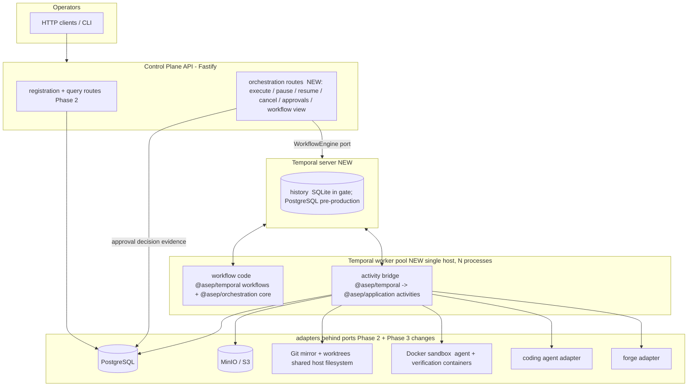

# Phase 3 — Durable Orchestration — Architecture (DRAFT, pending plan review)

> Companion to `phase-03-plan.md`. Base `00a6889` (head of `phase/02-single-agent-vertical-slice`, not yet
> accepted). Port signatures in §16 are design intent. The binding text is the shared-surface change requests
> in `phase-03-plan.md` §30, which the controller reconciles with Lane B before implementation.

## 1. Thesis and authority split

ADR 0001 assigns run/milestone/task durability, retries, timers, approvals and recovery to Temporal. ADR 0013
allows exactly one durable orchestrator. Phase 3 makes both concrete:

| Concern | Authority after Phase 3 | Not authoritative |
|---|---|---|
| What step runs next, retries, timers, pause, cancel, approval waits, budget decisions | **Temporal workflow history** | PostgreSQL rows, worker memory |
| Tenancy, run/task/attempt identity, leases, side-effect records, approvals evidence, budget ledger, audit | **PostgreSQL** (operational state and projection) | Temporal search attributes or memo |
| Artifact bytes | Object store (content-addressed) | — |
| Code and harness commits | Git (mirror + remote) | — |

The rule that keeps PostgreSQL from becoming a second orchestrator: **no activity reads a projected status
column to decide what the workflow does next.** Activities read PostgreSQL only for idempotency (natural keys,
side-effect records), fencing (epochs, leases), scope checks and evidence (approval decisions). Sequencing
decisions live only in workflow code. Chaos test F14 tampers with `tasks.status` mid-run and proves the
workflow ignores it and the projection self-corrects.

The Phase 2 sequential driver (`runVerticalSliceWorkflow`, `packages/application/src/vertical-slice-workflow.ts:273`)
stays in the tree **only as a test driver** for the step use cases, which is how Phase 2's K1 proofs run. No
production entrypoint may reach it after S8 (fitness rule, exit B8).

## 2. C4 — Container view (Phase 3 delta)



Long-running work never runs inside an HTTP request. That is unchanged from Phase 2. The API only starts
workflows, sends control messages, records approval decisions and queries.

## 3. Packages and layering (fitness-enforced)

```text
packages/orchestration   NEW  pure, deterministic workflow decision core
                              -> import type only: @asep/contracts, @asep/ports
                              -> NO runtime import of anything; NO node:*, Date, Math.random, timers
packages/application     EXTENDED  src/orchestration-activities/** (retry-safe activity implementations)
                              -> domain, contracts, ports, policy, observability (unchanged rule)
adapters/temporal        NEW  the ONLY package that imports @temporalio/*
  src/workflows/**            -> @temporalio/workflow + @asep/orchestration only
  src/activity-bridge/**      -> @temporalio/activity + @asep/ports types (wraps application activities)
  src/client/**               -> @temporalio/client (implements WorkflowEngine port)
  src/worker/**               -> @temporalio/worker (bundling, Worker.create factory)
workers/temporal-worker  NEW  composition root: build adapters -> createWorker(); no sequencing
apps/control-plane-api   EXTENDED  src/orchestration/** routes; production-root wires WorkflowEngine
```

Forbidden-import rules added (CR-12; each has a seeded-violation self-check like the Phase 2 rules):

| Rule | Scope | Detects |
|---|---|---|
| `@temporalio/*` confined | every package except `adapters/temporal` | any import or require of `@temporalio/` |
| workflow purity | `adapters/temporal/src/workflows/**` | any non-type import except `@temporalio/workflow`, `@asep/orchestration` and relative workflow modules |
| core purity | `packages/orchestration/src/**` | any non-`import type` import; tokens `Date`, `Math.random`, `setTimeout`, `setInterval`, `performance`, `process`, `crypto`, `require(`, `import(` |
| bundler truth | `adapters/temporal` | real `bundleWorkflowCode()` with no `ignoreModules` succeeds. A seeded `node:fs` workflow fixture fails. |
| no second driver | production entrypoints (`server-main`, `pilot-main`, `cli-main`, `workers/temporal-worker/src/main.ts`) | the import graph reaches `runVerticalSliceWorkflow`, `runVerticalSlice`, `governedExecution`, `completeToReview` or `executeTask` |
| activity options explicit | `adapters/temporal/src/workflows/**` | a `proxyActivities` option set without `retry.maximumAttempts`, `startToCloseTimeout` or (for long activities) `heartbeatTimeout` (unit test over the exported option table) |
| application stays engine-free | `packages/application/src/**` | `@temporalio/*` (added to the existing `FORBIDDEN_INFRA`, `scripts/forbidden-imports.test.ts:69`) |

## 4. Workflows

### 4.1 `taskWorkflow` (one per Task; workflow ID `asep-task-<taskId>`)

The deterministic core (`@asep/orchestration`) is a reducer `decide(state, event) -> { state, commands }`. The
Temporal workflow is a thin interpreter: it turns commands into activity calls and timers, and feeds activity
results, timer firings and messages back as events. The same reducer is driven by an in-memory sequential test
driver in S2, so the decision logic is proven without Temporal and then reused unchanged.

```text
ADMITTING ──(DEFERRED)──────────────────────────────────────────────▶ BLOCKED (terminal)
   │ admitted
   ▼
BUDGET_CHECK ──(reservation fails, approvals enabled)──▶ AWAITING_APPROVAL(budget-extension)
   │ reserved                                              │ approve → BUDGET_CHECK
   ▼                                                       │ reject/expire → BUDGET_EXHAUSTED (terminal)
ATTEMPT_STARTING  (ensureAttempt → acquireLease → prepareWorkspace → buildInputs)
   ▼
AGENT_RUNNING  (runAgent: engine maximumAttempts = 1; heartbeats; lease renewed on each tick)
   ▼ AGENT_DONE                         ▶ non-AGENT_DONE / timeout / worker death → ATTEMPT_ABANDONED
INSPECTING     (inspectWorkspace)       ▶ overstep → ATTEMPT_ABANDONED(policy-violation)
   ▼
VERIFYING      (runVerification)
   ├─ PASS ─▶ COMMITTING (commitAttempt) ▶ EVIDENCE (persistEvidence) ▶ REVIEW_SLOT(READY_FOR_REVIEW)
   └─ FAIL/ERROR ─▶ REVIEW_SLOT(VERIFICATION_FAILED)
REVIEW_SLOT decision:
   NOT_REQUIRED | APPROVED (READY_FOR_REVIEW only) ─▶ PUBLICATION_GATE
   REPAIR_REQUIRED, cycle < max, budget ok        ─▶ BUDGET_CHECK (next attempt, kind = repair)
   ESCALATE_TO_HUMAN | REPAIR_REQUIRED at max     ─▶ AWAITING_APPROVAL(review-adjudication)
   REJECTED                                       ─▶ FAILED (terminal)
PUBLICATION_GATE ──(publicationApprovalRequired)──▶ AWAITING_APPROVAL(publish-change)
   ▼
PUBLISHING  (publishBranch → upsertPullRequest)   [non-cancellable critical section]
   ▼
REVIEW_HANDOFF (projectTaskState WAITING_FOR_HUMAN_REVIEW) ─▶ CLEANUP ─▶ done

ATTEMPT_ABANDONED: reapContainers → quarantineWorkspace → releaseLease → record usage
   → BUDGET_CHECK (kind = retry) if the failure class is replaceable and attempts remain, else FAILED.
   Replaceable classes (policy default, `policies/orchestration-policy.yaml`): environment, provider,
   quota-rate-limit, tool, agent-loop-stall, artifact-loss, workflow-recovery-failure. Never replaceable:
   policy-violation, false-completion, duplicate-side-effect (Phase 1 taxonomy, `policies/failure-taxonomy.yaml`).
Any phase + cancel → CANCELLING (finish an open critical section, reap, quarantine, release) → CANCELLED.
Any phase boundary + pause → PAUSED (lease renewed by timer; pause timeout → BLOCKED).
```

**One-PR-per-task invariant.** A replacement attempt (kind `retry` or `repair`) is only ever started when no
`push` side-effect record exists for any earlier attempt of the task. Both slot calls happen before
publication. So at most one attempt per task publishes, and the task has at most one remote ref and one PR.
The core enforces this as a guard on the `startAttempt` command, and property tests check it.

Terminal outcomes and their projected `TaskStatus`: review handoff → `WAITING_FOR_HUMAN_REVIEW` (terminal for
the harness, as in Phase 2); `FAILED`; `BLOCKED` (deferred risk, publication rejected, pause timeout);
`BUDGET_EXHAUSTED`; `CANCELLED`. No phase leads to `ACCEPTED` or `DONE` (Phase 2 invariant I2 is preserved).

### 4.2 `runWorkflow` (one per Run; workflow ID `asep-run-<runId>`)

- Accepts `submitTask` Updates (update ID = `submit-<taskId>`, plus a workflow-side dedup set that survives
  continue-as-new). Tasks run **sequentially** in submission order as child `taskWorkflow`s
  (`ParentClosePolicy.REQUEST_CANCEL`).
- Owns the run budget. Each child starts with `remainingRunBudget` in its input. Children run one at a time, so
  the snapshot is exact and no cross-workflow reservation protocol is needed. The child returns its usage, and
  the run workflow appends it.
- Run-level pause/resume are forwarded to the active child as signals (idempotent flags with `requestId`). Run
  cancel cancels the active child through cancellation-scope propagation, then closes.
- Continue-as-new when `workflowInfo().continueAsNewSuggested`, after `allHandlersFinished`. Carried state:
  queue, dedup set, budget totals.
- **Deferred:** parallel tasks within a run, DAG ordering, cross-run fairness (see plan §4).

### 4.3 `workspaceJanitorWorkflow` (Temporal Schedule, every 15 min)

It sweeps leases that are `EXPIRED` or past `expires_at`. For each, it asks the `WorkflowEngine` whether the
owning task workflow is **closed**. Only then does it reap containers labelled with the attempt, quarantine the
workspace through the registry and mark the lease. It never touches a workspace whose workflow is still open:
live workflows clean up after themselves. This avoids a race between the janitor and a recovering workflow
(threat T3-09).

## 5. Activity catalog (explicit options, no defaults)

Durations are initial values in `@asep/orchestration`'s option table. A unit test (exit D3) asserts every entry
sets an explicit `retry`, `startToCloseTimeout` and, where marked, `heartbeatTimeout`.

| Activity | Wraps (Phase 2 step / port) | startToClose | heartbeat | retry max | Idempotency key / natural key | Cancellable |
|---|---|---|---|---|---|---|
| `admitTask` | `admitRisk` (`risk-admission.ts:82`) | 30 s | — | 3 | pure | yes |
| `ensureAttempt` | attempts repo (new natural key) | 30 s | — | 10 | `(task_id, attempt_number)` unique | yes |
| `acquireLease` | `WorkspaceLeaseRepository.acquire` (adopt semantics, CR-06) | 30 s | — | 10 | `(binding, branch)` ACTIVE + same `attempt_id` → adopt | yes |
| `prepareWorkspace` | `WorkspaceManager.create` (create-or-adopt, CR-07) | 5 min | 30 s | 3 | `workspaces.attempt_id` unique | yes |
| `storeAttemptInputs` | `ArtifactStore.put` for WorkOrder / ContextPack / RepairOrder refs | 2 min | — | 5 | content address | yes |
| `runAgent` | `agentStep` (`execute-task.ts:94`) | agent wall-clock + 5 min | 60 s | **1** | container `asep-agent-<attemptId>` (single run) | yes (aborts the provider; container reaped) |
| `inspectWorkspace` | `inspectStep` (`execute-task.ts:124`) | 5 min | 30 s | 3 | read-only | yes |
| `runVerification` | `verifyStep` (`pipeline-steps.ts:181`) | Σ check timeouts + 5 min | 30 s | 2 (infrastructure errors only) | reap `asep-verify-<attemptId>-*` first | yes |
| `reviewLoop` | `ReviewLoopPort.evaluate` (slot, §12) | 30 min | 60 s | 3 | `idempotencyKey = attemptId:trigger:cycle` | yes |
| `commitAttempt` | `commitStep` (`pipeline-steps.ts:342`) + fence + HEAD CAS | 5 min | 30 s | 10 | side-effect `attemptId:commit` | **no** (non-cancellable scope) |
| `persistEvidence` | `evidenceStep` (`pipeline-steps.ts:475`) | 5 min | 30 s | 10 | preallocated evidence id (adopt) | no |
| `publishBranch` | `pushStep` (`pipeline-steps.ts:609`) + fence | 5 min | 30 s | 20, backoff to 5 min | side-effect `attemptId:push`; remote ref | no |
| `upsertPullRequest` | `upsertPrStep` (`pipeline-steps.ts:692`) + fence | 5 min | 30 s | 20, backoff to 5 min | side-effect `attemptId:pr-upsert`; PR head | no |
| `projectTaskState` / `projectAttemptState` | projection writer (§13) | 30 s | — | 50, backoff to 1 min | monotonic `projection_seq` | no |
| `recordUsage` | budget ledger | 30 s | — | 10 | `(attempt_id, entry_kind)` unique | no |
| `openApprovalRequest` / `verifyApprovalDecision` / `expireApprovalRequest` | approvals repo | 30 s | — | 10 | `approval_requests.id` deterministic from workflow (§11) | no |
| `renewLease` | `WorkspaceLeaseRepository.renew` (CR-06) | 30 s | — | 5 | lease id | yes |
| `reapContainers` | `ExecutionReaper.reap` (CR-08) | 2 min | — | 10 | label `asep.attempt` | no |
| `quarantineWorkspace` / `cleanupWorkspace` / `releaseLease` | Phase 2 ports via registry | 2 min | — | 10 | idempotent by id | no |
| `emitRunEvent` | run-event sink | 30 s | — | 10 | `eventId = <workflowId>:<seq>` | no |

**Error mapping.** The activity bridge converts these errors into `ApplicationFailure.nonRetryable` with
`type` = error name, and the workflow core maps each type to a failure class: `SideEffectFingerprintError`,
`SideEffectFencingError`, `SideEffectResultRefError`, `EvidenceIdentityMismatchError`,
`SandboxIsolationRequiredError`, `ScopeViolationError`, `BaseShaError`, `WorktreeContainmentError`, the
ref-safety errors, `ReviewLoopUnavailableError`, `ProjectionOwnershipError` and `WorkspaceUnavailableError`. All
other errors are retryable up to the table's limit. A table-driven test pins the mapping (exit D4). Failure
classes come from activities, which call the Phase 1 `classifyFailure`. The workflow never reads policy YAML.

**Why the agent is never engine-retried.** The agent mutates a worktree and spends money. A blind re-run on a
half-mutated worktree is neither idempotent nor honest about cost. Phase 1's domain model already says
"retries create new attempts; attempts are never overwritten" (`docs/architecture/03-domain-model.md:27-29`).
So the engine retry is 1, and recovery from worker death during `runAgent` is a **new attempt** in a fresh
worktree, after reaping the old container. This is allowed only while no remote side effect exists (§4.1
invariant).

## 6. Determinism boundary and workflow versioning

1. **Code purity.** Fitness rules in §3, plus the real bundler test.
2. **Inputs.** Workflow inputs, Update/Signal payloads and results are DTOs that validate against three
   canonical JSON Schemas (CR-02): `task-workflow-input/v1`, `run-workflow-input/v1` and `workflow-control/v1`.
   They contain IDs, hashes, `ArtifactRef`s, numbers and closed enums only, with no source text, prompts,
   command strings or credentials. Verification commands are referenced by **check id**. The activity resolves
   check id → `CommandSpec` from approved project configuration, so no shell string ever crosses the workflow
   boundary (same rule as Phase 2, `phase-02-plan.md` §13). Validation happens at the API boundary and again at
   the start of the first activity. Workflow code does not import the `@asep/contracts` validators, because
   they would pull runtime dependencies into the workflow bundle.
3. **Payload changes** are governed by the existing compat gate (MINOR for additive optional fields, MAJOR with
   a new `$id` for breaking changes). A breaking payload change needs a new workflow type name
   (`taskWorkflowV2`), never an in-place edit.
4. **Code changes** after the first release use `patched('<change-slug>')`. Slugs are behavior names, not plan or
   finding IDs (project rule).
5. **Replay corpus.** `adapters/temporal/test-histories/*.json` holds histories exported from the S7/S9/S10 real
   runs (synthetic IDs only, scanned by the secret, PII and large-file gates). `pnpm test` replays them offline
   with `Worker.runReplayHistories`. A divergence fails the canonical gate (`asep-suite:temporal-replay`). A
   seeded non-deterministic change to a fixture workflow proves that the suite turns red.

## 7. Fencing and crash-safety model

Three layers, each needed because the one above it can be bypassed by a zombie worker. A zombie is a paused
process that resumes after Temporal has already retried its activity elsewhere.

1. **Record fencing (PostgreSQL).** Every side-effect activity delivery first calls
   `AttemptFence.claim(attemptId, leaseId)`. This is an atomic `fencing_epoch = fencing_epoch + 1 … RETURNING`
   on the attempt row, which yields token `{leaseId, epoch}`. `SideEffectLog.begin` with epoch `E`:
   - no record → insert `PENDING`, `owner_epoch = E`;
   - `PENDING` with `owner_epoch < E` → **atomic takeover** (`owner_epoch`, `owner_token` and `taken_over_from`
     updated under `version` CAS; audited as `side-effect.takeover`), returned with `takenOver: true`. The
     caller then reconciles by natural key exactly as Phase 2 does (`pipeline-steps.ts:374-398,627-644,737-754`);
   - `PENDING`/`FAILED` with `owner_epoch > E` → `SideEffectFencingError` (the caller is the zombie);
   - `COMPLETED` → adopted, as in Phase 2 (fingerprint must match).
   `complete`/`fail` require `owner_epoch == E`. This removes the Phase 2 wedge where a re-leased executor could
   never finish a crashed executor's `PENDING` row. The Phase 2 test that pins the wedge is
   `adapters/persistence/src/side-effect-log.test.ts:255`, and the fencing check is `side-effect-log.ts:174-181`.
2. **Local CAS (Git).** `GitCommitter.commit` takes `expectedHeadSha` (the pinned base) and refuses unless HEAD
   still equals it, using `git update-ref HEAD <new> <expected>` semantics. A zombie's late commit fails instead
   of stacking a second object on top.
3. **Remote idempotency (forge).** A push targets an exact, attempt-namespaced ref with an exact commit SHA
   (`forge-provider.ts:160-170`), and a PR upsert is keyed by head branch. A late duplicate call converges to the
   same ref and the same PR. The activity also checks `ctx.signal.aborted` and `AttemptFence.assertCurrent`
   **immediately before** each external call, which narrows the zombie window. The convergence assertions
   (§8) count forge **calls**, not just end state, so any regression shows up.

Leases. `renew` extends `expires_at` (today `heartbeat` only touches `heartbeat_at`,
`lease-repository.ts:83-89`, so a long agent run outlives its TTL). It returns `LOST` when the lease is no longer
`ACTIVE`. `acquire` adopts an `ACTIVE` lease held by the **same** attempt on the same branch. Today it returns
`LeaseDenied` for that case (`lease-repository.ts:75-79`), which wedges an engine retry after a crash that
followed the insert. Constants: heartbeat tick 10 s, Temporal `heartbeatTimeout` 60 s, lease renewal on every
tick throttled to 60 s, lease TTL 10 min. Temporal detects a dead worker long before the lease expires. Lease
expiry only matters for long outages, and then the next activity delivery re-acquires and takes over through
the epoch.

Workspaces. `GitWorktreeManager` keeps path, baseline refs and base SHA in process memory
(`worktree-manager.ts:60-71`), mints its own workspace ID (`:108`) separately from the lease row's workspace ID
(`lease-repository.ts:43`), and `pathOf()` throws for unknown IDs (`:142-147`). After a worker restart no
workspace can be inspected, committed, reconciled or cleaned up. Phase 3 adds a durable `workspaces` registry
(data-model §3.4). The manager rehydrates path, base SHA and baseline refs from it, and `create` becomes
create-or-adopt keyed by attempt.

Containers. Agent and verification containers get deterministic names (`asep-agent-<attemptId>`,
`asep-verify-<attemptId>-<checkId>`) and labels (`asep.attempt`, `asep.role`, `asep.org`, `asep.project`).
`ExecutionReaper.reap(attemptId)` force-removes them. It runs before any retry or replacement of a container
activity, on cancel, and from the janitor.

## 8. Recovery matrix (what "recover without duplicate side effects" means)

The external and durable effects are enumerated, and each has a uniqueness invariant. Every chaos test ends by
calling one helper (`assertConvergence`) that checks all of them against real PostgreSQL, the real bare remote,
the forge double's call log, the object store and `docker ps`:

| Effect | Invariant after recovery |
|---|---|
| attempt rows | ≤ `maxAttempts` per task; `attempt_number` contiguous; no two rows with the same number |
| harness commits | ≤ 1 commit with `ASEP-Attempt: <attemptId>` per attempt; the published commit equals `attempts.result_sha` equals `EvidenceBundle.resultSha` |
| remote refs | exactly 1 ASEP ref for the task when published, 0 otherwise; never a protected ref |
| forge PR create calls | ≤ 1 per task (call log), and exactly 1 PR for the task when published |
| side-effect records | 1 row per `(attempt, operation)`; terminal `COMPLETED`/`FAILED`; no `PENDING` at workflow close |
| evidence | 1 bundle per published attempt, stored at the trailer's preallocated id |
| budget ledger | 1 `attempt-usage` row per attempt |
| approval requests and decisions | 1 request per gate instance; ≤ 1 decision per request |
| containers | 0 containers labelled with the task's attempts after close |
| leases | 0 `ACTIVE` leases for the task after close |
| run events | `workflow.recovered` emitted for each recovery, with `recoveryKind` |

Crash points. The chaos worker's `FaultInjector` blocks at a named point and the test then SIGKILLs the process.
The points are: after `ensureAttempt` insert; after lease insert; after workspace `git worktree add`; mid-agent
(container running); mid-verification (container running); for each of commit/push/PR: after `begin`, after the
external call, after `complete`; after evidence object write but before metadata insert; between projection
writes. The full matrix and its expected outcomes are in `phase-03-plan.md` §22.

## 9. Pause, resume, cancel

| Control | Delivery | Semantics |
|---|---|---|
| pause | Update `control` (`kind: pause`, `requestId`) via API | Takes effect at the next phase boundary. An in-flight activity is not interrupted. The workflow waits on `condition(() => !paused \|\| cancelRequested, pauseTimeout)` and runs a `renewLease` timer loop meanwhile. Projection becomes `PAUSED`. Repeating the same `requestId` is a no-op. Pausing a paused workflow returns `accepted: false` with reason `already-paused`. |
| resume | Update `control` (`kind: resume`) | Clears the flag and continues from the recorded phase. Projection returns to the phase's status. |
| pause timeout | durable timer (policy `maxPauseHours`, default 72) | → reap, quarantine, release, `BLOCKED` (`reason: pause-timeout`), audit. |
| cancel | Temporal workflow cancellation through the API | If a non-cancellable critical section (commit … PR) is open, it finishes first and its records complete, so cancellation never leaves `PENDING` records. Then a cleanup scope reaps containers, quarantines the workspace, releases the lease and projects `CANCELLED`. A published PR is **left open** for a human (the harness never deletes remote refs; Phase 2 RefSafetyPolicy forbids deletion). Cancellation after publication is audited with the PR reference. |
| run-level pause/resume/cancel | Update on `runWorkflow` | Forwarded to the active child (signal for pause/resume, scope cancellation for cancel). No new child starts while the run is paused. |

Every control requires an authenticated principal with capability `executions:control` for the task's project.
Each one is audited (`workflow.pause`, `workflow.resume`, `workflow.cancel`) and emits `human.intervention`
with `interventionKind`.

## 10. Budgets

| Level | Source | Enforced by | Hard rule |
|---|---|---|---|
| attempt | `WorkOrder.budget` (`maxTurns`, `maxToolCalls`, `maxCostUsd`, `maxWallClockMinutes`) | provider adapter (Phase 2) + activity `startToClose` = wall-clock + grace | the provider is killed on wall-clock expiry |
| task | `task-workflow-input.taskBudget` (`maxAttempts`, `maxCostUsd`, `softCostUsd`, `maxWallClockMinutes`) | `taskWorkflow` core | **reservation:** an attempt starts only if `spent + attempt.maxCostUsd ≤ maxCostUsd + granted extensions` |
| run | `run-workflow-input.runBudget` (`maxCostUsd`, `softCostUsd`, `maxTasks`) | `runWorkflow` core | the child's task cap is `min(task cap, run remaining)` |
| tenant / project / milestone | — | **deferred** | needs cross-run accounting, deferred with the fair scheduler (plan §4) |

- Crossing a soft threshold emits `budget.threshold_crossed` (`thresholdKind: soft`) and an audit row. Work
  continues.
- A failed hard reservation pauses into a `budget-extension` approval when the run allows approvals. Otherwise,
  or on reject or expiry, the task ends `BUDGET_EXHAUSTED`.
- **Verification is never reduced to fit a budget** (`docs/implementation/cost-model.md:12`). Budget checks run
  only at `BUDGET_CHECK`, before an attempt starts. Once an agent attempt has run, verification, commit and
  publication of that attempt are never skipped or shortened for budget reasons. Test H5 exhausts the budget
  during the agent step and asserts verification still runs every mandatory check.
- Usage source: `AgentAttemptObservation.usage` is **provider-reported and untrusted**
  (`packages/ports/src/index.ts:49-57`). Wall-clock is measured by the harness. The ledger records `source`
  per entry. If reported cost exceeds the reservation, that is recorded as an overrun event and the task budget
  is treated as exhausted. Residual risk: a provider that under-reports cost is bounded only by its own
  enforcement of `maxCostUsd` (PR3-16).

## 11. Approvals

A durable, human-only gate. It reuses the Human-approval sequence (`docs/architecture/05-sequence-diagrams.md:36-54`)
and keeps ADR 0014's named approval with rationale.

- **Kinds in Phase 3:** `budget-extension`, `publish-change` (required when the run's
  `publicationApprovalRequired` is true; set at run creation by a principal with `runs:govern`, and immutable
  afterwards), and `review-adjudication` (from the review slot).
- **Request.** The workflow derives the request ID deterministically (`<workflowId>:<gateSeq>`). Activity
  `openApprovalRequest` inserts it idempotently with `expires_at`, `kind`, a non-secret payload and evidence
  `ArtifactRef`s. The projection becomes `WAITING_FOR_APPROVAL`, and `approval.requested` is emitted.
- **Decision path.** `POST /v1/approvals/:id/decision` authenticates the principal, checks
  `approvals:decide` on the project, rejects self-approval (`decided_by ≠ requested_by`), validates the
  decision against the kind's allowed set, and inserts the `approval_decisions` row, which is unique per request
  and is the human-accountability evidence. It then delivers Update `control` (`kind: approval-decision`,
  `decisionId`, `updateId = decisionId`).
- **Workflow validator** rejects, without touching state: wrong request ID, request not pending, decision not
  allowed for the kind, or a second **different** decision. A repeated identical delivery returns the original
  receipt. After acceptance the workflow runs `verifyApprovalDecision`, which re-reads the PostgreSQL decision
  row and checks request, decision, principal and that the principal is not an agent or service principal,
  before acting. A Temporal message alone can never release a gate (threat T3-02).
- **Expiry** is a workflow timer, authoritative over `expires_at`. On expiry: `expireApprovalRequest`
  (idempotent), `approval.expired`, and the kind's reject path. A late decision gets HTTP 409, and the validator
  rejects it.
- **Allowed decisions per kind.** `budget-extension`: approve (with `extensionUsd ≤ policy max`) or reject.
  `publish-change`: approve or reject. `review-adjudication`: on `READY_FOR_REVIEW`, approve, reject or
  request-repair; on `VERIFICATION_FAILED`, request-repair or reject only. A human can never approve past failed
  mandatory verification (ADR 0010: deterministic evidence is stronger than review).

## 12. Review-loop slot (Lane B plugs in here)

A named, typed activity, `reviewLoop`, behind `ReviewLoopPort` (`slotVersion: 'review-loop/v1'`, declared in
`packages/ports`, CR-10). Lane B implements it as framework-free application code and never imports
`@temporalio/*` or anything Lane A adds. The contract:

- **Call sites:** after `runVerification` with `trigger: VERIFICATION_FAILED`, and after `persistEvidence` with
  `trigger: READY_FOR_REVIEW`. Both come before publication.
- **Input:** IDs, risk, cycle and max cycles, implementer provider ID, `ArtifactRef`s (work order, context pack,
  diff, verification artifacts, evidence and result SHA when ready), prior review report refs, remaining budget,
  and an `idempotencyKey`.
- **Output** is a closed union: `NOT_REQUIRED`, `APPROVED`, `REPAIR_REQUIRED(repairOrderRef)`,
  `ESCALATE_TO_HUMAN`, `REJECTED`. Each carries the review report refs. The workflow fails closed on contract
  violations: `NOT_REQUIRED` or `APPROVED` on `VERIFICATION_FAILED`; a missing `repairOrderRef`; unknown kinds.
  Each is audited as `review-slot.contract-violation`, and the task ends `FAILED`.
- **Repair** is Lane A's composition: a new attempt of kind `repair` whose agent request carries
  `repairOrderRef` (CR-10 adds this optional field to `AgentExecuteRequest`), then verify, then the slot again
  with `cycle + 1`. The repair worktree is created at the task's pinned `baseSha`. Before the agent runs, the
  harness applies the parent attempt's captured diff artifact (checksum-verified, trusted `git apply` to the
  working tree only; HEAD stays at base). Each attempt's commit is therefore the **full** change against the
  pinned base, and its verification and evidence cover the whole change, not just the repair delta (CR-07
  `seedDiffRef`).
- **Obligations on implementations:** idempotent on `idempotencyKey`; no worktree mutation (Review "does not
  mutate implementation worktrees", `docs/architecture/02-bounded-contexts.md:23`); refs-only output under
  64 KB; honour `ctx.signal`; heartbeat at least every 30 s.
- **Phase 3 default implementation** (`PolicyOnlyReviewLoop`, Lane A, in the application layer):
  `READY_FOR_REVIEW` returns `NOT_REQUIRED` only when the Phase 2 admission decision already accounts for
  review: R0 (`independentReviewers: 0`) or R1 (human independent review recorded after the PR, as in
  Phase 2). Otherwise it throws `ReviewLoopUnavailableError` (non-retryable). R2–R4 never reach it because
  admission defers them. `VERIFICATION_FAILED` returns `REJECTED("verification failed; no automated repair
  wired")`, which keeps Phase 2 behavior. The controller replaces the binding with Lane B's implementation at
  integration, in the composition root only.

## 13. Projection to PostgreSQL

`projectTaskState` and `projectAttemptState` write
`status, projection_seq, projection_updated_at, workflow_id` with
`UPDATE … WHERE id = $id AND scope matches AND (workflow_id IS NULL OR workflow_id = $wf) AND projection_seq < $seq`.
Zero rows means: equal-or-newer `seq` → idempotent no-op; different `workflow_id` → `ProjectionOwnershipError`
(non-retryable; two orchestrators for one task). Set-once facts (`result_sha`, evidence attachment, PR row) use
"set if null, else must be equal". These replace the version-CAS updates that the Phase 2 driver issues at the
end of a run (`vertical-slice-workflow.ts:525-551`), which would raise `OptimisticConcurrencyError` on an engine
retry. `seq` is the workflow's own monotonic counter, deterministic on replay.

## 14. Worker topology and its guard

Phase 3 supports **N worker processes on one host** that share the workspace root and the Git mirror. That is
enough for worker-kill recovery, because filesystem state survives process death. Multi-host distribution is
deferred (plan §4): worktrees and the mirror are host-local, so it needs host-affine task queues or shared
workspace storage. Guard: the `workspaces` row records `host_id`. A workspace activity on a different host fails
with `WorkspaceUnavailableError` (non-retryable). The workflow then treats the attempt as abandoned, and only if
no push record exists; it never proceeds on a missing worktree. A test runs two workers with different
`ASEP_WORKER_HOST_ID` values and proves the guard.

## 15. Observability

- **Spans** (CR-18): `orchestration.workflow.task`, `orchestration.workflow.run`, `orchestration.activity`
  (attribute `asep.activity`), `orchestration.message`. Each carries the Phase 2 correlation set plus
  `workflow_id`, `activity_attempt` and `fencing_epoch`. Existing Phase 2 boundary spans (`git.commit`,
  `forge.push`, …) still fire inside the activities via the Phase 2 `observe` seam (`pipeline-steps.ts:870-877`).
- **Audit actions** (CR-18): `workflow.start`, `workflow.pause`, `workflow.resume`, `workflow.cancel`,
  `approval.request`, `approval.decide`, `approval.expire`, `budget.threshold`, `budget.extend`,
  `side-effect.takeover`, `workspace.quarantine`, `review-slot.contract-violation`.
- **RunEvents** (persisted in `run_events`, validated against `run-event/v1.2.0`, CR-03): `run.started`,
  `task.started`, `attempt.started`, `attempt.declared_complete`, `verification.completed`, `attempt.completed`,
  `task.completed`, `run.completed`, `human.intervention`, `workflow.recovered` (with `recoveryKind`),
  `approval.requested`, `approval.expired`, `budget.threshold_crossed`. These feed the existing
  `workflow_recovery_rate` and `human_intervention_rate` metrics, plus `duplicate_side_effect_incidents` (CR-19).
  Dashboards are Phase 4 scope (90-day plan Days 46–60). Phase 3 supplies the data.
- **Payload hygiene.** Temporal history is visible to anyone with namespace access. Payloads are refs-only
  (§6). A test scans every exported replay-corpus history with the repo's secret and PII patterns.

## 16. Port signatures (design intent; binding text is plan §30)

```typescript
// Engine-neutral activity context. Application activities receive this; only the
// Temporal activity bridge knows how it maps to @temporalio/activity.
export interface ActivityProgress {
  readonly stage: string;
  readonly detail?: Readonly<Record<string, string | number | boolean>>;
}
export interface ActivityExecutionContext {
  readonly engineAttempt: number;              // 1-based delivery count of this activity
  readonly signal: AbortSignal;                // engine cancel, heartbeat timeout, worker shutdown
  readonly lastProgress: ActivityProgress | null;
  heartbeat(progress: ActivityProgress): void; // non-secret, small
}

export interface FencingToken { readonly leaseId: string; readonly epoch: number; }
export interface AttemptFence {
  claim(scope: TenantScope, input: { attemptId: AttemptId; leaseId: string }): Promise<FencingToken>;
  assertCurrent(scope: TenantScope, input: { attemptId: AttemptId; token: FencingToken }): Promise<void>;
}

export type LeaseRenewal =
  | { readonly status: 'RENEWED'; readonly expiresAt: string }
  | { readonly status: 'LOST'; readonly state: 'RELEASED' | 'EXPIRED' | 'QUARANTINED' | 'MISSING' };

export interface ExecutionReaper {
  reap(scope: TenantScope, input: { attemptId: AttemptId; role?: 'agent' | 'verify' }): Promise<{ removed: number }>;
}

export interface ReviewLoopPort {
  readonly slotVersion: 'review-loop/v1';
  evaluate(scope: TenantScope, request: ReviewLoopRequest, ctx: ActivityExecutionContext): Promise<ReviewLoopDecision>;
}

export interface WorkflowEngine {   // replaces the unused Phase 1 shape at packages/ports/src/index.ts:81-86
  startRun(scope: TenantScope, input: RunWorkflowInput): Promise<WorkflowStartReceipt>;
  submitTask(scope: TenantScope, input: { readonly runId: RunId; readonly task: TaskWorkflowInput; readonly requestId: string }): Promise<WorkflowStartReceipt>;
  control(scope: TenantScope, message: WorkflowControlMessage): Promise<WorkflowControlReceipt>;
  describeTask(scope: TenantScope, taskId: TaskId): Promise<TaskWorkflowView | null>;
  isClosed(scope: TenantScope, workflowId: string): Promise<boolean>;
}
```

The full request and decision types, receipts and views are in `phase-03-plan.md` §30 (CR-04 … CR-10).
