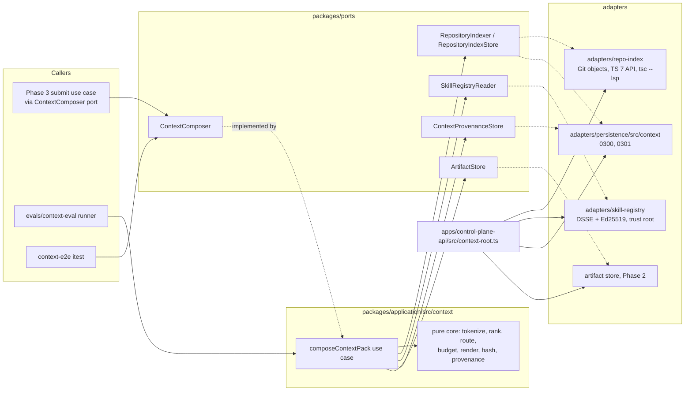

# Phase 5 — Architecture (DRAFT v1)

> Companion to `phase-05-plan.md`. Base `f613c7f`. Where this document and the reconciliation disagree, the
> reconciliation wins.

## 1. Thesis

Git, PostgreSQL, Temporal history and immutable artifacts stay authoritative (ADR 0002). Phase 5 adds three
derived things and one rule:

- a **repository index**, derived from Git objects at one commit and stored as an immutable artifact;
- a **skill registry**, a directory of files whose every byte is checked against an operator-signed index;
- a **ContextPack composed by the harness**, canonical and hashed, with a provenance record that names every input;
- the rule: a change to how context is built or skills are routed is accepted only with a recomputed scorecard on
  a fixed corpus (plan §9).

Nothing here decides workflow, approval or acceptance (ADR 0008, ADR 0013).

## 2. Components



`context-root.ts` is the only place the four adapters meet. It is a sibling of `production-root.ts` (R10), and
Lane A imports it when it binds `ContextComposer` into its submit use case (CR-P5-12).

## 3. Layering and fitness

| Package | May import | May not import |
|---|---|---|
| `packages/application/src/context/**` | `@asep/contracts`, `@asep/ports`, `@asep/policy`, `node:crypto`, the review-loop `canonicalJson` (`../review-loop/slot-rules.js`, read only) | any adapter, `typescript`, `node:child_process`, `node:fs`, `node:http(s)`, `node:net` |
| `adapters/repo-index` | `@asep/ports`, `@asep/contracts`, `@asep/git-worktree` (`runGit`), `typescript` 7.0.2, `node:child_process`, `node:fs` | `fetch`, `node:http(s)`, `node:net`, any other adapter |
| `adapters/skill-registry` | `@asep/ports`, `@asep/contracts`, `node:crypto`, `node:fs`, `yaml` | `fetch`, `node:http(s)`, `node:net`, `node:child_process` |
| `adapters/persistence/src/context` | as the rest of `@asep/persistence` | — |
| `evals/context-eval` | `@asep/application`, `@asep/repo-index`, `@asep/skill-registry`, `@asep/policy`, `@asep/contracts` | a second implementation of ranking or routing (E2 checks function identity) |
| `apps/**`, `workers/**` | `context-root.ts` only through its exported factory | `createEvaluationSkillRegistry` (CR-P5-09) |

The fitness rules of CR-P5-09 are written against the AST framework Phase 2 landed (R8,
`scripts/lib/ts-guard.mjs`), each with a seeded-violation self-check.

## 4. Repository index

### 4.1 Snapshot

The indexer never checks out a worktree and never runs repository code.

1. `runGit(['--git-dir', mirror, 'cat-file', '-e', `${sha}^{commit}`])`: absent → `RepositoryIndexUnavailableError
   'base-sha-missing'` (retryable once the mirror is fetched; the indexer does not fetch, as Phase 2 does not,
   `worktree-manager.ts:117-121`).
2. `git ls-tree -r -z --full-tree <sha>` lists entries. Mode `100644`/`100755` → candidate file; `120000`
   (symlink) and `160000` (submodule) → recorded as skipped. A path with a `..` segment, a leading `/`, a control
   character or more than 1024 bytes → skipped `invalid-path`. Entries beyond `maxFiles` → `over-file-cap`, and the
   files map is `partial`.
3. `git cat-file --batch` streams each candidate blob. A blob above `maxFileBytes` or containing NUL in its first
   8 KiB is recorded (`oversize`, `binary`) and its content is not used.
4. Text blobs are written as regular files under a fresh `mkdtemp` directory, opened with `O_CREAT|O_EXCL` and no
   symlink anywhere in the tree. The root is used by its real path (§2 of the plan: the probe needed it).
5. Workspace links: for each `package.json` in the snapshot that names a dependency resolved inside the snapshot
   (pnpm workspace protocol or a name matching another snapshot package), create
   `<pkg>/node_modules/<name>` as a **relative** symlink to that package's directory, pnpm style. These links are
   the only symlinks, they point inside the root, and the probe showed they are what makes cross-package references
   resolve.
6. The snapshot directory is removed in `finally`, also on abort.

### 4.2 Maps

| Map | How | Failure → |
|---|---|---|
| lexical | split every text blob on non-alphanumerics and camelCase boundaries, lower-case, keep tokens of 3–64 chars not in the policy stopword list; postings sorted by file index | — (pure) |
| symbols | `typescript/unstable/sync` `API`: load every `tsconfig.json` project of the snapshot (or one synthetic project of all `.ts`/`.js` files when none exists), walk each source file's top-level statements: functions, classes, interfaces, type aliases, enums, variables, namespaces, with `exported` and 1-based line | a project that fails to load → its files have no symbols; `symbols: partial` |
| dependencies | for each import or export-from specifier, the TS checker's resolved module; an edge only when the target is a snapshot file | unresolved specifier → no edge (external packages are not resolved, by design) |
| references | one `tsc --lsp --stdio` process per index build, run with `cwd` = snapshot root and an environment of `PATH` and `HOME=<tmp>` only; `initialize` with the root, `textDocument/didOpen` of one file per project (forces each project to load), then `textDocument/references` (`includeDeclaration: false`) for each exported top-level declaration of a `source` file, pipelined; URIs outside the root are dropped | request timeout or more than `maxReferenceQueries` → `references: partial`; server crash → `references: absent`; `serverInfo` other than `typescript-go <typescriptVersion>` → the build fails `tool-failed` |
| tests | files matching the policy's test patterns (`**/*.test.ts`, `**/*.itest.ts`, `**/test/**`, `**/__tests__/**`) → the transitive closure of their in-snapshot import edges, restricted to `source` files | — (pure over the import graph) |

The TypeScript version is read twice — `tsc --version` and the LSP `serverInfo` — and must agree. It is written
into the index. No other host tool version enters the index bytes: Git output (tree listing and blob bytes) does
not depend on the Git version.

### 4.3 Bytes, digest, determinism

- The index is `repository-index/v1`, serialized as canonical JSON (§7) and validated before it is returned.
- Everything in it is sorted: files by path; tokens by token; postings, edges, references and tests by file index.
- `indexerDigest` = sha256 hex of the canonical JSON `["repository-index", INDEXER_VERSION, typescriptVersion,
  limits]`. It is the cache key with the binding and the commit.
- A golden test indexes a committed fixture repository and compares the bytes with a committed golden index that
  carries `indexerVersion`. A change that alters the output must update the golden file and bump
  `INDEXER_VERSION` in the same commit (I5).
- Two builds of the same key produce the same bytes (I5).

### 4.4 Caps (policy, recorded in `limits`)

`maxFiles` 20 000; `maxFileBytes` 1 MiB; `maxReferenceQueries` 4 000; `lspRequestTimeoutMs` 10 000;
`buildTimeoutMs` 300 000; `maxIndexBytes` 32 MiB (over it the build fails `tool-failed`; nothing partial is
stored).

## 5. Skill registry

### 5.1 Layout

```text
skills/
  vendor/NOTICE.md                                attribution for every vendored source
  vendor/<source>/LICENSE                         upstream license text, verbatim
  vendor/<source>/<skill>/SKILL.md                upstream bytes, verbatim (pinned git blob SHA)
  vendor/<source>/<skill>/skill.json              ASEP skill-manifest/v1
  registry/trust-root.json                        skill-trust-root/v1 (keys: [] until the operator adds one)
  registry/quarantine.json                        import record of every candidate (internal format)
  registry/index.dsse.json                        signed registry index (absent until an operator signs one)
```

The production reader takes three settings from `context-root.ts`: the registry directory, the trust root path
and `minimumSequence`. `skills: none` is an explicit fourth option and yields an empty registry with mode `none`.
A configured registry whose index file is missing fails closed.

### 5.2 Signed index

- Payload: canonical JSON bytes of an in-toto Statement v1:
  `{"_type": "https://in-toto.io/Statement/v1", "subject": [{"name": "<skillId>@<version>", "digest": {"sha256":
  "<bundleSha256>"}}, …], "predicateType": "https://asep.dev/attestation/skill-registry-index/v1", "predicate":
  <skill-registry-index/v1>}`. Subjects are sorted by name and must equal the releases one for one.
- Envelope: DSSE v1.0.2 `{"payload": base64(payload), "payloadType": "application/vnd.in-toto+json",
  "signatures": [{"keyid": "<keyId>", "sig": base64(sig)}]}`.
- Signature: Ed25519 (`crypto.sign(null, PAE, privateKey)`) over
  `PAE = "DSSEv1" SP LEN(payloadType) SP payloadType SP LEN(payload) SP payload`, `LEN` in ASCII decimal bytes.
- `keyId` = sha256 hex of the public key's SPKI DER.

### 5.3 Verification order (fail closed; nothing is returned before every step passes)

1. Read the trust root, validate `skill-trust-root/v1`, recompute every `keyId` from its key. → `trust-root-invalid`
2. Read the envelope; it must be exactly the DSSE shape with one signature and `payloadType`
   `application/vnd.in-toto+json`. → `envelope-invalid`
3. `keyid` must name a trust-root key with role `registry-index`. → `unknown-key`
4. Verify the Ed25519 signature over PAE. → `signature-invalid`
5. Parse the payload; it must be the Statement shape above with `predicate` valid against
   `skill-registry-index/v1` and subjects equal to the releases. → `statement-invalid`
6. `issuedAt` must lie within the key's `validFrom`–`validUntil`. → `key-not-valid`
7. `now < expiresAt`, with `now` read once per load. → `index-expired`
8. `sequence ≥ minimumSequence`. → `sequence-below-minimum`
9. For each release with status `promoted` (others are not loaded): read every file of its directory once into
   memory; the set of files must equal the listed set (→ `bundle-unlisted-file`), each sha256 and size must match
   and the bundle digest must match (→ `bundle-mismatch`); `skill.json` must validate `skill-manifest/v1` with the
   same id and version (→ `manifest-invalid`); `SKILL.md` must have valid frontmatter whose `name` equals its
   directory name and a UTF-8 body within the policy's size cap (→ `instructions-invalid`).
10. Return the releases built from the bytes verified in step 9. Nothing is read from disk again.

### 5.4 Evaluation mode

`createEvaluationSkillRegistry(quarantinePath)` reads `quarantine.json` and the candidate files with the same
digest checks as step 9, with no signature, and returns `mode: 'evaluation'` releases with status `quarantined`.
The composer refuses an evaluation registry (`evaluation-registry-refused`) unless it was constructed with
`allowEvaluationRegistry: true`, which only `evals/context-eval` passes. A fitness rule keeps the factory out of
`apps/**` and `workers/**` (CR-P5-09).

### 5.5 Operator CLI (`scripts/skills/registry.mjs`)

`keygen <priv.pem> <pub.pem>` · `trust-root add <pub.pem> --valid-until <date>` (prints the entry to commit) ·
`sign --key <priv.pem> --sequence <n> --expires <date> --promote <skillId@version>…` (builds the index from
`quarantine.json` and the files on disk, signs it, writes `index.dsse.json`) · `verify` (runs §5.3). The private key
is read from a path given on the command line and never written anywhere else, the same model as
`scripts/sign-acceptance.sh`.

## 6. Composition

### 6.1 Inputs

The caller's request (`ContextComposeInput`, §8), the WorkOrder bytes read from the artifact store, the index
snapshot, the verified registry and `policies/context-policy.yaml` (with the sha256 of its raw bytes).

### 6.2 Pure pipeline

1. **Query.** Tokenize `workOrder.objective` with the index tokenizer; unique, sorted.
2. **File ranking** (integers; `idf(t) = floor(1 000 000 / df(t))`, `df` = files holding `t`):
   - `lexical(f) = Σ_{t ∈ q, f ∈ postings(t)} W_LEX × idf(t) × min(count(t, f), 3)`
   - `symbol(f) = Σ_{s declared in f} W_SYM × |tokens(name(s)) ∩ q|`
   - `reference(f) = Σ_{s matched, f ≠ decl(s)} W_REF × min(refCount(s, f), 5)` over symbols with at least one name
     token in `q`
   - seeds = the top `L` files by `lexical + symbol`; `dependency(f) = W_DEP × |{g ∈ seeds : g→f or f→g}|`
   - `test(f) = W_TEST × |{g ∈ seeds : f is a test of g}|`
   - `score = lexical + symbol + reference + dependency + test`; files with `score > 0`, ordered by
     `(−score, path)`; the first `K`. No padding: fewer than `K` matches give fewer files.
   - `ranking.mode: path-order` (the evaluation's trivial baseline only) ignores every signal and takes the first
     `K` files with role `source` or `test` in path order.
   - Each file records whether it lies inside `workOrder.allowedPaths`; ranking does not filter on it (reading is
     not writing).
3. **Symbols.** Matched symbols ordered by `(−|tokens ∩ q|, path, name)`; the first `M`, as `path#name`.
4. **Skill routing.**
   - Candidates: releases whose `activation.phases` contains `implementation` and whose
     `compatibility.languages` is empty or meets the index's languages.
   - Permission filter: `permissions.network = none`, `permissions.productionAccess = forbidden`,
     `permissions.tools ⊆ allowedTools`, `permissions.tools ∩ disallowedTools = ∅`. Each exclusion is recorded.
   - Required skills: each `workOrder.requiredSkills` ref must equal a filtered candidate's id and version, or the
     composition stops with `unknown-skill` before any write.
   - Score: `Σ_{t ∈ q ∩ tokens(id, description, taskTypes)} floor(1 000 000 / df_skills(t))`, `df_skills` over the
     candidates' token sets.
   - Primary: a required primary, else the best `primary` candidate scoring at least `minPrimaryScore`, else none.
   - Adjuncts: required adjuncts, then the best `adjunct` candidates scoring at least `minAdjunctScore`, at most
     `maxAdjuncts` (2) in total, dropping the lower of any `conflictsWith` pair.
   - Verification bundle: `policy.verificationSkill` when it is a candidate, role `verification`.
5. **Budgets.** Instructions are never cut. Over `maxSkillBytes`, drop in order: ranked adjuncts from the lowest
   score, the verification skill, the ranked primary. Required skills are never dropped: if they alone exceed the
   budget, `over-budget`. Then the rendered pack must be at most `maxPackBytes`, else `over-budget`.
6. **Render.** `id = "ctx-" + inputDigest[0..32)`; `generatedAt`, `baseSha`, `objective`,
   `architectureInvariants` from the request and the WorkOrder; `specificationExcerpt` = `"Requirements: …;
   Acceptance checks: …"` from the WorkOrder ids; `relevantFiles`, `relevantSymbols`; `priorEvidenceIds: []`;
   `skills` in the order primary, adjuncts by score, verification, each with `bundleSha256`, `role` and
   `instructions`; `allowedTools`; `deniedOperations` = `workOrder.forbiddenChanges` then `disallowedTools`;
   `hash` = `contextPackHash(pack)`.
7. **Provenance.** `context-provenance/v1` with the request, its digest, the input digests, every ranked file with
   its per-signal scores, symbols, skills with reasons, exclusions and budgets.

### 6.3 Idempotency and crash behaviour

- Keyed by `(scope, taskId)`. `requestDigest` = sha256 of canonical
  `[repositoryBindingId, taskId, baseSha, workOrderRef.artifactId, workOrderRef.sha256, allowedTools,
  disallowedTools]`. `generatedAt` is not part of it: a retried submit at a later time gets the first composition.
- Recorded row with an equal `requestDigest` → its refs, `reused: true`, nothing written. A different digest →
  `conflicting-input`, nothing written.
- The two artifact puts are content-addressed and create-only; the row is the last write and the only authority. A
  crash between a put and the row is recomposed on retry; if the registry or index changed in between, the first
  attempt's artifacts are orphans, never referenced.

### 6.4 Errors

| Code | Retryable | Raised when |
|---|---|---|
| `work-order-invalid` | no | the WorkOrder artifact does not validate `work-order/v1` |
| `base-sha-mismatch` | no | `workOrder.baseSha ≠ input.baseSha` |
| `unknown-skill` | no | a required skill is not a filtered candidate |
| `registry-unverifiable` | no | `SkillRegistryReader.load()` threw (its code is in the detail) |
| `evaluation-registry-refused` | no | an evaluation registry reached a production composer |
| `index-unavailable` | yes | `RepositoryIndexUnavailableError` (base SHA or mirror missing, tool failure, cancel) |
| `over-budget` | no | required skills or the rendered pack exceed the budget |
| `conflicting-input` | no | a different request for a task that already has a composition |

Store and artifact errors propagate as thrown errors, retryable by the existing convention ("any other thrown error
is transient").

## 7. Canonical encodings and digests

| Name | Definition |
|---|---|
| canonical JSON | `canonicalJson` of `packages/application/src/review-loop/slot-rules.ts:28` (keys sorted at every level, no whitespace, `JSON.stringify` scalars), UTF-8. Reused, not copied. |
| `contextPackHash(pack)` | `"sha256:" + hex(sha256(canonicalJson(pack without hash)))` |
| context-pack artifact bytes | `canonicalJson(pack)`; the artifact's `sha256` is over these bytes, `hash` included |
| bundle digest | `sha256(canonicalJson(files))`, `files` = `[[path, sha256, size], …]` of the skill directory, sorted by path |
| manifest digest | sha256 of the `skill.json` bytes |
| `keyId` | sha256 hex of the Ed25519 public key's SPKI DER |
| registry `sourceSha256` | sha256 of the DSSE payload bytes (the statement), or of the `quarantine.json` bytes |
| `indexerDigest` | §4.3 |
| `requestDigest` | §6.3 |
| `inputDigest` | sha256 of canonical `[requestDigest, generatedAt, policySha256, indexSha256, indexerDigest, registry mode, registry name, registry sourceSha256, registry sequence, composerVersion]` |

## 8. Port text (CR-P5-02, appended to `packages/ports/src/index.ts`)

```typescript
// ---------------------------------------------------------------------------
// Context platform: repository index, skill registry, context composition.
// ContextComposer is the member other components call. The rest are the
// composer's dependencies, declared here so the application core and the
// adapters share them without importing each other.
// ---------------------------------------------------------------------------

export interface RepositoryIndexKey {
  readonly repositoryBindingId: RepositoryBindingId;
  /** The commit, 40 lower-case hex. */
  readonly baseSha: string;
  /** sha256 hex of the indexer version, the TypeScript version and the caps. */
  readonly indexerDigest: string;
}

export interface RepositoryIndexer {
  readonly indexerDigest: string;
  /**
   * The canonical repository-index/v1 bytes of the binding's commit, built from
   * Git objects alone. Runs no repository code. A reached cap is recorded in the
   * index's capabilities; it is not an error.
   */
  build(scope: TenantScope, input: {
    readonly repositoryBindingId: RepositoryBindingId;
    readonly baseSha: string;
    readonly signal: AbortSignal;
  }): Promise<Uint8Array>;
}

/** The index cannot be built now. Retryable once the cause is gone. */
export class RepositoryIndexUnavailableError extends Error {
  constructor(
    readonly reason: 'base-sha-missing' | 'mirror-missing' | 'tool-failed' | 'cancelled',
    detail: string,
  ) {
    super(`repository index unavailable (${reason}): ${detail}`);
    this.name = 'RepositoryIndexUnavailableError';
  }
}

export interface RepositoryIndexSnapshotRecord extends RepositoryIndexKey {
  /** ULID of the snapshot row. */
  readonly snapshotId: string;
  /** Kind 'repository-index'. */
  readonly indexRef: ArtifactRef;
}

export interface RepositoryIndexStore {
  find(scope: TenantScope, key: RepositoryIndexKey): Promise<RepositoryIndexSnapshotRecord | null>;
  /** Create-once by key: the same indexRef again returns the record; another throws RepositoryIndexConflictError. */
  record(scope: TenantScope, input: RepositoryIndexKey & { readonly indexRef: ArtifactRef }): Promise<RepositoryIndexSnapshotRecord>;
}

export class RepositoryIndexConflictError extends Error {
  constructor(detail: string) {
    super(`repository index conflict: ${detail}`);
    this.name = 'RepositoryIndexConflictError';
  }
}

export interface VerifiedSkillRelease {
  readonly skillId: string;
  readonly version: string;
  /** A production registry returns promoted releases only; an evaluation registry, quarantined ones. */
  readonly status: 'promoted' | 'quarantined';
  readonly manifest: SkillManifest;
  readonly bundleSha256: string;
  /** The SKILL.md body after its frontmatter, decoded from the verified bytes. */
  readonly instructions: string;
}

export interface VerifiedSkillRegistry {
  readonly mode: 'production' | 'evaluation' | 'none';
  /** The statement's registry name (production); null for evaluation and none. */
  readonly registry: string | null;
  /** sha256 hex of the signed statement (production) or of the quarantine record (evaluation); null for none. */
  readonly sourceSha256: string | null;
  readonly sequence: number | null;
  readonly trustRootSha256: string | null;
  readonly releases: readonly VerifiedSkillRelease[];
}

export interface SkillRegistryReader {
  /** Verifies the trust root, the signature, expiry, sequence and every file before it returns anything. */
  load(): Promise<VerifiedSkillRegistry>;
}

export type SkillRegistryRefusal =
  | 'trust-root-invalid' | 'envelope-invalid' | 'unknown-key' | 'signature-invalid' | 'statement-invalid'
  | 'key-not-valid' | 'index-expired' | 'sequence-below-minimum' | 'bundle-unlisted-file' | 'bundle-mismatch'
  | 'manifest-invalid' | 'instructions-invalid';

export class SkillRegistryVerificationError extends Error {
  constructor(readonly code: SkillRegistryRefusal, detail: string) {
    super(`skill registry refused (${code}): ${detail}`);
    this.name = 'SkillRegistryVerificationError';
  }
}

export interface ContextProvenanceRecord {
  readonly repositoryBindingId: RepositoryBindingId;
  readonly taskId: TaskId;
  /** Kind 'context-pack'. */
  readonly contextPackRef: ArtifactRef;
  /** Kind 'context-provenance'. */
  readonly provenanceRef: ArtifactRef;
  readonly indexSnapshotId: string;
  /** sha256 hex of the caller's request (architecture §6.3). */
  readonly requestDigest: string;
}

export interface ContextProvenanceStore {
  findByTask(scope: TenantScope, taskId: TaskId): Promise<ContextProvenanceRecord | null>;
  findByPack(scope: TenantScope, contextPackRef: ArtifactRef): Promise<ContextProvenanceRecord | null>;
  /** Create-once per task: an equal record returns created false; a different one throws ContextCompositionError 'conflicting-input'. */
  record(scope: TenantScope, rec: ContextProvenanceRecord): Promise<{
    readonly record: ContextProvenanceRecord;
    readonly created: boolean;
  }>;
}

export interface ContextComposeInput {
  readonly repositoryBindingId: RepositoryBindingId;
  readonly taskId: TaskId;
  /** 40 lower-case hex; must equal the work order's baseSha. */
  readonly baseSha: string;
  /** Kind 'work-order', already stored; the composer reads and validates it. */
  readonly workOrderRef: ArtifactRef;
  readonly toolPolicy: Pick<ToolPolicyProfile, 'allowedTools' | 'disallowedTools'>;
  /** The caller's logical time, ISO-8601 UTC. The composer reads no clock for the pack. */
  readonly generatedAt: string;
  readonly signal: AbortSignal;
}

export interface ContextComposeResult {
  /** Kind 'context-pack'; hand it to the agent as is, never re-serialized. */
  readonly contextPackRef: ArtifactRef;
  /** Kind 'context-provenance'. */
  readonly provenanceRef: ArtifactRef;
  /** True when the task already had this composition. */
  readonly reused: boolean;
}

export type ContextCompositionRefusal =
  | 'work-order-invalid' | 'base-sha-mismatch' | 'unknown-skill' | 'registry-unverifiable'
  | 'evaluation-registry-refused' | 'index-unavailable' | 'over-budget' | 'conflicting-input';

export class ContextCompositionError extends Error {
  constructor(readonly code: ContextCompositionRefusal, readonly retryable: boolean, detail: string) {
    super(`context composition refused (${code}): ${detail}`);
    this.name = 'ContextCompositionError';
  }
}

export interface ContextComposer {
  /** Idempotent by (scope, taskId). Every refusal comes before the first artifact write. */
  compose(scope: TenantScope, input: ContextComposeInput): Promise<ContextComposeResult>;
}
```

`SkillManifest` is imported from `@asep/contracts` (generated type). `ToolPolicyProfile`, `ArtifactRef`,
`TenantScope`, `RepositoryBindingId` and `TaskId` already exist in the ports file or contracts.

## 9. Integration seams

### 9.1 Phase 3 (CR-P5-12)

```text
POST /v1/tasks/:taskId/executions  (Lane A's route and use case)
  store the WorkOrder artifact (Lane A, as planned)
  if a ContextComposer is bound:
      body.contextPack present → 400
      { contextPackRef } ← composer.compose(scope, { binding, taskId, baseSha, workOrderRef, toolPolicy,
                                                      generatedAt: the use case's logical time })
      ContextCompositionError retryable:false → 4xx / non-retryable activity failure; retryable → 503 / retry
  else: today's path (validate and store the body's pack)
  task-workflow-input.contextPackRef ← that ref
storeAttemptInputs (Lane A's activity): attach contextPackRef to the attempt as is
```

No schema changes: `task-workflow-input` already carries `contextPackRef`. The joint itest (compose → submit →
first attempt's `context_pack` = the composed ref → provenance row found by pack) lands with CR-P5-12.

### 9.2 Phase 4 (CR-P5-11)

`buildRepairContextPack` reads the original pack by ref, changes `objective`, `specificationExcerpt` and
`priorEvidenceIds` as its plan says, keeps every other field (the 1.1.0 skill fields included), and sets `hash`
with `contextPackHash`. A parity test in Lane B's suite checks a repair pack's `hash` against `contextPackHash`.

### 9.3 Phase 2

Unchanged. The agent adapter fetches the pack by `ArtifactRef`, re-hashes it and mounts it read-only
(`claude-provider.ts:694-700`). The attempt binds it by scoped FK (`migrations.ts:944-951`).

## 10. Evaluation runner

```text
for item in manifest.items (sorted by id):
  indexBytes ← RepositoryIndexer(production class, mirror = this repository's git common dir).build(parent)
  registry   ← createEvaluationSkillRegistry(skills/registry/quarantine.json)
  workOrder  ← synthesized work-order/v1: objective = item.objective, baseSha = parent, risk R0,
               allowedPaths ['**'], requiredSkills [], fixed budget
  for variant in [default, lexical-only, no-references, no-test-map, path-order]:
      pack, provenance ← composeContextPack (the function @asep/application exports), in-memory stores,
                         allowEvaluationRegistry: true, policy = default with the variant's overrides
      record ranks of gold files, primary skill, pack bytes
aggregate per variant and split (integers) → scorecard (canonical JSON) → report.md (generated)
```

Each index is built once per item and shared by the five variants. The in-memory stores are doubles of storage
only; the indexer, registry reader and composer are the production code.

## 11. Trust boundaries (summary; details in the threat model delta)

```text
UNTRUSTED                                  TRUSTED (harness)
repository content (blobs, tsconfig,       indexer: parses only, regular files only, caps, no network,
  package.json, identifiers)                 minimal env, child processes killed on abort/timeout
vendored skill text                        registry reader: verifies every byte against an operator-signed
                                             index; text is data inside the pack
WorkOrder (human-authorized, Phase 2/3)    composer: pure, deterministic, records why
operator signing key  ── never on the harness host's checkout; only public keys are committed
```
