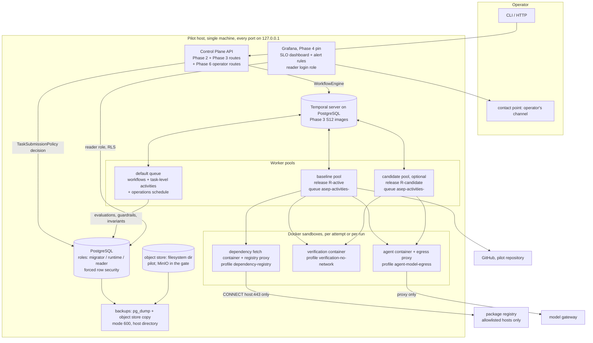

# Phase 6 — Brownfield and Production Hardening — Architecture (DRAFT v1)

> Companion to `phase-06-plan.md`. Base `f613c7f`. Phase 3 and Phase 4 designs are read from their locked plans on
> `phase/03-durable-orchestration` (`2c63fbd`) and `phase/04-independent-assurance` (`e750d4c`). Port signatures
> here are design intent; the binding text for shared ports is plan §19.1.

## 1. Thesis and authority split

Phase 6 adds no new orchestrator and no new source of truth. It adds **policies** (data, pinned against the code
that applies them), **decisions taken before a workflow starts** (one seam), **observers** (evaluations over
authoritative data) and **operator actions** (incidents, kill switches, rollback, retention), each recorded.

| Concern | Authority | Not authoritative |
|---|---|---|
| Whether a task may start, its verification plan, its release | the `TaskSubmissionPolicy` decision, recorded once per task in PostgreSQL | the workflow core (it only executes the input it is given) |
| Workflow progress, retries, controls | Temporal history (Phase 3, unchanged) | Phase 6 tables |
| Baselines, readiness, autonomy, releases, incidents, holds, kill switches, SLO evaluations | PostgreSQL (Phase 6 tables) and immutable artifacts | Grafana, dashboards, notifications |
| What a worker pool runs | its harness release manifest, checked at startup | environment variables alone |
| Whether an SLO is breached | `slo_evaluations` rows written by the evaluator | Grafana's own query state (it only displays and notifies) |
| Promotion of a module or a release | a named human decision row | any score, comparison or schedule |

Two rules keep the ownership single (ADR 0013):

1. **Phase 6 never decides inside a running workflow.** Admission, plan and routing are fixed at submission. A later
   change of state (demotion, rollback, kill switch) acts on running workflows only through Phase 3's controls
   (`WorkflowEngine.cancel`, pause) and Phase 3's reaper, never by a workflow reading a Phase 6 table.
2. **Phase 6 never writes run events.** `run_events` keeps its FK onto `runs` and holds operational events of real
   runs only (Phase 3 data model §3.7, R15). Phase 6 reads run events and writes its own tables.

## 2. C4 — Container view (production pilot, Phase 6 delta)



## 3. Packages and layering

```text
packages/application/src/brownfield/**    h2   onboarding steps, classification, scoring, autonomy admission, demotion
packages/application/src/release/**       h4   assignment, pool pin check, guardrails, rollback, promotion
packages/application/src/operations/**    h4   SLO evaluation activity, invariant checks
packages/application/src/credentials/**   h3   kill switch use cases and decorators over ports
packages/application/src/retention/**     h3   eligibility, sweeps, holds
packages/application/src/hardening/**     lead submission composer, default policy, incidents
packages/observability/src/slo/**         h4   SLO catalog loader, burn-rate evaluator (pure)
packages/policy/src/{network,credential,retention,readiness-scoring,autonomy,release}-policy.ts   loaders (pure)
adapters/network-policy/**                h3   NEW package: registry proxy asset, DependencyMaterializer on Docker
adapters/persistence/src/{brownfield,release,operations,retention,tenancy,incidents}/**   repositories, migrations' itests
adapters/temporal/src/workflows/{onboarding,operations}/**, src/operations/history-exporter.ts   carve-outs (CR-L4)
apps/control-plane-api/src/{brownfield,release,operations,security,hardening}/**          routes, CLI, itests
apps/control-plane-api/src/hardening-root.ts                                             sibling composition root (R10)
deploy/pilot/**                                                                          deployment recipe
```

Dependency rules are Phase 2's (`phase-02-plan.md` §7) unchanged: application code imports domain, contracts, ports,
policy and observability; adapters import ports and their own SDK or tool; only `adapters/temporal` imports
`@temporalio/*`; no Phase 6 application module imports an adapter. The registry proxy and the dependency materializer
use Node built-ins and the Docker CLI only (no new dependency).

Fitness checks Phase 6 adds, each package-local with a seeded violation (the pattern of Phase 3's
`packages/orchestration/src/purity.test.ts`), so the shared fitness files need no Phase 6 edit:

| Check | Where | Detects |
|---|---|---|
| no automatic promotion | `packages/application/src/release/no-auto-promotion.test.ts`, `brownfield/no-auto-promotion.test.ts` | an import edge from guardrail, schedule or demotion modules to the promotion modules; a promotion entry point whose decider type is not `HumanDecision` |
| policy parity | `adapters/network-policy/src/profile-parity.test.ts`, `packages/application/src/credentials/credential-parity.test.ts` | drift between the declared policies and the Phase 2 builders and constants |
| runtime role cannot rewrite history | `adapters/persistence/src/tenancy/roles-rls.itest.ts` | a `DELETE`, `UPDATE`, `TRUNCATE` or `ALTER TABLE … DISABLE TRIGGER` the runtime role is allowed to run on an append-only table |

## 4. The task-submission seam

```mermaid
sequenceDiagram
  participant C as Client
  participant API as Phase 3 submitTask use case
  participant P as TaskSubmissionPolicy (composed)
  participant B as brownfield admission (h2)
  participant R as release routing (h4)
  participant E as WorkflowEngine
  C->>API: POST /v1/tasks/:id/executions (work order, context pack, plan id)
  API->>API: validate, authorize, store work order
  API->>P: decide(scope, {task, binding, risk, baseSha, allowedPaths, requestedChecks})
  P->>B: admission + checks (autonomy map, baseline)
  B-->>P: ADMIT | ADMIT_WITH_PUBLICATION_APPROVAL | REFUSE(reason), checks
  P->>R: routing (assignment pinned per task)
  R-->>P: harnessReleaseId, activityTaskQueue
  P-->>API: decision (recorded, idempotent on taskId)
  alt REFUSE
    API-->>C: 409 {refusal}; audit submission.refused; no workflow
  else admitted
    API->>E: submitTask(input with checks, publicationApprovalRequired, activityTaskQueue)
  end
```

- **Composition.** The verdict is the most restrictive of the parts (`REFUSE` > `ADMIT_WITH_PUBLICATION_APPROVAL` >
  `ADMIT`). Checks come from the brownfield part when the binding is baselined, otherwise they are the requested
  checks unchanged. Routing comes from the release part. `AdmitAllSubmissionPolicy` returns `ADMIT`, the requested
  checks and no routing, so the default is byte-identical to Phase 3 without Phase 6.
- **Idempotence.** Each part writes its own decision row keyed by task id (`task_autonomy_decisions`,
  `task_release_assignments`); a repeated submission returns the recorded rows, so a client retry cannot move a task
  to another cohort or plan.
- **Never weakening.** The brownfield part may add advisory checks and choose which approved command fills a
  mandatory level; it may never mark a mandatory level advisory or drop one. The composer refuses a part's output
  that has fewer mandatory levels than `policies/verification-matrix.yaml` requires for the risk.

## 5. Brownfield onboarding

```mermaid
sequenceDiagram
  participant OPR as Operator
  participant W as onboardingWorkflow (carve-out)
  participant A as onboarding activities (h2)
  participant WS as Phase 2/3 workspace + lease
  participant DM as DependencyMaterializer (h3)
  participant RN as Phase 2 runner, verification sandbox
  participant ST as artifacts + PostgreSQL
  OPR->>W: start (binding, pinned SHA, onboarding policy hash) via WorkflowEngine
  W->>A: secret-pattern scan of the pinned tree (trusted Git blobs; nothing runs)
  A->>ST: onboarding_secret_findings rows (path, blob, pattern id, line; never the text)
  alt findings and no acknowledgement
    W-->>OPR: SCAN_BLOCKED; wait for a human acknowledgement (signal through WorkflowEngine)
  end
  loop k = 1..K
    W->>A: prepare run k
    A->>WS: lease asep-onboarding/<runId>/<k>, worktree at pinned SHA
    A->>DM: materialize (none | vendored | registry)
    DM-->>A: result + raw logs + egress log refs
    A->>RN: each approved command (no network)
    RN-->>A: exit, signal, timeout, stdout/stderr refs
    A->>ST: baseline_command_runs rows
    A->>WS: cleanup / quarantine, release lease
  end
  W->>A: classify + write brownfield-baseline/v1
  W->>A: collect readiness evidence, score, write readiness-report/v1
  W->>A: write autonomy-map v1 (every module L0) if none exists
```

| Stage | Input | Output | Idempotence key |
|---|---|---|---|
| register | binding, pinned SHA, policy hash | `onboarding_runs` row | `(binding, pinned_sha, policy_sha256)` |
| scan | pinned tree, pattern set | `onboarding_secret_findings` rows, counts on the run | `(onboarding_run_id, path, pattern_id, line)` |
| run k | worktree at pinned SHA | `baseline_command_runs` rows, raw artifacts | `(onboarding_run_id, command_id, run_index)` |
| classify | K runs per command | `baseline_classifications`, `brownfield-baseline/v1` | `onboarding_run_id` |
| score | baseline, repository at SHA, Git history, attestations | `readiness-report/v1` | `(onboarding_run_id, scoring_policy_sha256)` |
| map v1 | readiness report | `autonomy-map/v1` version 1 | `(binding, version)` |

Classification is a pure function of the K recorded runs: all exit 0 → `stable-pass`; all non-zero exit →
`known-failing`; any timeout, signal or classified tool fault → `infrastructure-error`; otherwise `flaky`. It is
recomputed from the rows, never edited.

**Characterization tasks** use the ordinary task pipeline. The submission policy recognises them (every
`allowedPaths` entry falls under the touched modules' test globs, checked with Git pathspecs), admits them at L0 with
publication approval, and plans the module's test command K times. CR-X1 makes sure the verified tree is the committed
tree.

## 6. Readiness scoring

| Dimension | Checks (initial policy) | Evidence | Kind |
|---|---|---|---|
| build reproducibility | the module's build command is `stable-pass` across K runs after a clean materialization | baseline rows | measured |
| test strength | at least one `stable-pass` test command maps to the module; test files map to the module's source (Phase 5 static test map of `repository-index/v1`, TypeScript only) | baseline; Phase 5 index (G-P5IDX) | measured (second check `not-evidenced` until G-P5IDX, and for modules the index does not cover) |
| architecture clarity | an approved fitness or architecture check covering the module is `stable-pass`; else a human attestation (capped at half the points) | baseline; attestation | measured / attested |
| documentation | a README, AGENTS.md or docs index in the module or repository root at the SHA; its last change within the policy window of the module's last code change | repository at SHA; `git log` | measured |
| observability | the module emits telemetry and has dashboards | attestation | attested |
| deployment safety | a rollback procedure and feature flags exist for the module | attestation | attested |
| isolation | every approved command of the module passes in the no-network sandbox after materialization | baseline | measured |
| ownership | `CODEOWNERS` at the SHA covers every module path | repository at SHA | measured |
| task modularity | share of the last N commits touching the module that also touch another module | `git log --name-only` (trusted Git) | measured, heuristic |
| historical stability | share of the last N commits touching the module whose subject starts with `revert` or `fix` | `git log` (trusted Git) | measured, heuristic |

Each check has points, a reason and evidence. Attestations are named (human principal), carry a rationale stored in
PostgreSQL only, and expire; an expired attestation scores as `not-evidenced`. The scorer is a pure function of
(evidence set, scoring policy); the same inputs give byte-identical `readiness-report/v1` bytes. The report shows
measured and attested points separately and states that weights and bands are uncalibrated policy.

## 7. Autonomy enforcement and demotion

```text
autonomy map (versioned)  ──▶  submission: level = min(level of every module the allowedPaths touch)
                                             (no module → L0; empty allowedPaths → every module)
                                 L0: tests-only scope → ADMIT_WITH_PUBLICATION_APPROVAL; else REFUSE(module-read-only)
                                 L1: ADMIT_WITH_PUBLICATION_APPROVAL
                                 L2: ADMIT
operations schedule (1 min) ──▶ attributed violation since the map's version? (false completion, policy violation,
                                 scope violation, from run_events joined to tasks and the decision row's modules)
                                 yes → new map version (modules → L0, decidedByClass harness, triggering event id)
                                     → WorkflowEngine.cancel for every open task whose decision row names the module
                                     → audit autonomy.demote
promotion (route, capability autonomy:decide, class human) → new map version citing a readiness report
```

The publication approval for L0 and L1 uses Phase 3's existing `publish-change` approval and its human-only decision
route (Phase 3 plan §19), so Phase 6 adds no approval machinery.

## 8. Network profiles and the registry proxy

```text
fetch container ──(internal network, isolated gateway, no DNS)──▶ registry proxy ──(egress network)──▶ registry host:443
  HTTPS_PROXY=http://proxy:3128                                    CONNECT allowlist by host name
  package manager, scripts off                                     refuse: IP literal, port ≠ 443, plain HTTP,
  read-only rootfs, caps dropped,                                  absolute-form, any host not allowlisted,
                                                                   a name resolving to loopback, link-local,
                                                                   private or metadata addresses
  writable: worktree + store dir only                              log: host, port, decision, bytes
```

- Profiles and their maximum allowlists are declared in `policies/network-policy.yaml`. A project overlay is
  intersected with the platform maximum; a widening fails at load.
- Parity: the test builds the flags of each profile with the real builders (`buildSandboxRunFlags`,
  `buildAgentRunArgs`, `buildProxyRunArgs`, and the new fetch builder) and compares them with the declaration
  (network mode, internal network, read-only rootfs, capabilities, the proxy's allowed methods and paths). Drift in
  either direction is red.
- The fetch container follows Phase 2's container lifetime rules (named, labelled `asep.role=dependency-fetch`,
  `asep.attempt` or `asep.onboarding`, removed and shown gone within a bound; `phase-02-architecture.md` §7) through
  the exported teardown helpers of `adapters/command-runner`.
- Untrusted repository configuration: a repository `.npmrc` may carry only allowlisted keys; every lockfile tarball
  URL host must be allowlisted; install scripts never run while the network exists. Builds that need scripts run in
  the no-network verification sandbox afterwards.

## 9. Credentials and kill switches

```typescript
// application-local (packages/application/src/credentials/ports.ts)
export type CredentialClass =
  | 'model-api-key' | 'github-app-private-key' | 'github-installation-token'
  | 'reviewer-gateway-key' | 'object-store-key' | 'database-role' | 'grafana-admin';
export type KillSwitchScope =
  | { readonly level: 'platform' }
  | { readonly level: 'organization'; readonly organizationId: OrganizationId }
  | { readonly level: 'project'; readonly organizationId: OrganizationId; readonly projectId: ProjectId };
export interface CredentialKillSwitch {
  /** Reads authoritative state on every call; no cache. A wider engaged scope covers a narrower one. */
  isEngaged(scope: TenantScope, credentialClass: CredentialClass): Promise<boolean>;
}
```

| Class | Decorator / action while engaged | Bound |
|---|---|---|
| `model-api-key` | the decorator around Phase 2's `ModelCredentialProvider` refuses, so a new attempt is BLOCKED before its proxy starts; open attempts in scope have their `asep.role=egress-proxy` containers reaped through Phase 3's `ExecutionReaper` | within one schedule interval plus the reaper's removal bound |
| `github-installation-token` | a `ForgeProvider` decorator refuses every call; no new token is minted (tokens expire after one hour) | immediate for new calls |
| `reviewer-gateway-key` | a decorator around Phase 4's credential source refuses | immediate for new calls |
| others | recorded and audited; rotation follows the runbook | — |

Engaging or releasing a switch needs `credentials:kill` and is an audit row and a `credential_kill_switches` row.
Engaging is always allowed; releasing needs a human principal.

## 10. Roles and row security

```sql
-- shape of 0490 (full text in the data model); roles are created by the deployment bootstrap or the gate
-- for every table T with a column organization_id (enumerated from the catalog inside the migration):
alter table T enable row level security;
alter table T force row level security;
create policy asep_migrator_all on T to asep_migrator using (true) with check (true);
create policy asep_runtime_all  on T to asep_runtime  using (true) with check (true);   -- Phase 6: permissive
create policy asep_reader_tenant on T for select to asep_reader
  using (organization_id in (select organization_id from reader_role_scopes where role_name = current_user));
-- grants from table_access_classes: mutable → select, insert, update; append-only → select, insert; reference → select
```

- A tenant table without forced row security and the three policies fails the catalog itest; so does a table
  missing from `table_access_classes`.
- The runtime role owns nothing, so it cannot `ALTER TABLE … DISABLE TRIGGER`, drop a policy or truncate; on
  append-only tables it has no `UPDATE` or `DELETE` grant either, which makes the append-only triggers a second line.
- Superusers and `BYPASSRLS` roles bypass row security (research register §5); the gate and the bootstrap create no
  application role with either attribute, and the itest asserts it.

## 11. Retention

```text
policy (class per artifact kind and per tenant table) ─▶ eligibility (pure): age > retention ∧ ¬held ∧ ¬referenced by
                                                          a non-terminal or under-review task
  ─▶ dry-run sweep: report artifact (ids, kinds, sizes, sha256, reason) ─▶ human approval (retention:approve)
  ─▶ execute: per artifact, tombstone row first (artifact_purges), then delete the bytes; a crash between the two
     leaves a tombstone over bytes that still exist, and the next sweep deletes them (idempotent)
reads: RetentionAwareArtifactStore checks artifact_purges first → ArtifactPurgedError; verify likewise
```

Holds are rows (`retention_holds`) with a scope (artifact, attempt, task, run, release) and a reason (incident, pilot
evidence, legal, review); a hold is released only by a human. Unknown artifact kinds fall into the policy's `default`
class, which never purges, and an invariant check raises a ticket for them.

## 12. Harness releases, pools, canary and rollback

```text
release states:  REGISTERED ──▶ CANARY ──▶ ACTIVE ──▶ RETIRED
                      │            │
                      │            └──▶ ROLLED_BACK   (guardrail or human)
                      └──────────────▶ ACTIVE         (first release only, by a human)
invariants: at most one ACTIVE, at most one CANARY (partial unique indexes); every transition is a row with actor
            class (human | guardrail) and reason; CANARY → ACTIVE requires actor class human
```

```mermaid
sequenceDiagram
  participant S as operations schedule (1 min)
  participant G as guardrail evaluation (h4)
  participant DB as PostgreSQL
  participant E as WorkflowEngine
  S->>G: evaluate candidate cohort since canary start
  G->>DB: read run_events ⨝ task_release_assignments, invariant_violations
  alt any guardrail breached
    G->>DB: release_transitions CANARY → ROLLED_BACK (actor guardrail), stop assignment
    G->>E: cancel open candidate tasks (safety classes)
    G->>DB: audit release.rollback; release_guardrail_evaluations row
  else clean
    G->>DB: release_guardrail_evaluations row (relative comparisons with Wilson intervals, reported only)
  end
```

- **Pool start.** `assertWorkerMatchesRelease(manifest, effective)` compares agent image digest, CLI version, model
  id, egress-proxy, verification and fetch image digests, the policy file hashes the attempt path reads, and the
  worker build SHA. Any difference stops the process before it polls.
- **Drift audit.** An invariant check compares each attempt's invocation manifest (Phase 2 records images, model and
  CLI per attempt) with its task's release; a difference is `release-pin-drift` (page).
- **Rollback of a pool.** After a rollback the operator drains the candidate pool (Phase 3 drain order: stop
  assignment, wait until no open task is assigned to it, stop the pool). A task assigned to a pool that is gone fails
  closed at schedule-to-start; the drain rule prevents it, and the runbook covers it.

## 13. SLO evaluation and alerting

```text
run_events ──▶ Phase 4 evaluator (ratio SLIs over windows 5m, 30m, 1h, 6h, 3d, 30d)
authoritative tables ──▶ invariant checks ──▶ invariant_violations (deduplicated by check and subject)
                     both ──▶ SLO evaluator (pure) ──▶ slo_evaluations (append-only; state ok | ticket | page | unknown)
                                                     └──▶ Grafana panels and alert rules (reader role) ──▶ contact point
deadman: alert when max(evaluated_at) is older than 5 minutes (Grafana rule on the same data source)
```

- Burn rate for a window = (bad / total in the window) / (1 − objective). A row fires when both its long and short
  windows exceed its factor (SRE workbook, research register §3). Below the minimum event count of the long window a
  bad event yields `ticket`.
- Zero-tolerance SLOs: any violation in the window → `page`. `unknown` when the source is missing (for example
  before Lane A emits `workflow.recovered`); `unknown` is shown and alerts as a ticket, never as `ok`.
- Alert annotations carry the SLO name, state, counts and ids only (threat T6-16), and a `runbook_url` to the runbook
  section for that alert; a test checks every URL resolves to a heading.

## 14. Incident tooling

| Action | Effect | Record |
|---|---|---|
| open | incident row, scopes from the window or release named; holds on every attempt in scope; history export of the affected workflows into held artifacts; scope report artifact | `incidents`, `incident_scopes`, `incident_actions`, audit `incident.open` |
| contain | one or more of: pause or cancel workflows, roll back the release, engage kill switches, reap containers | an `incident_actions` row per action, each with its result |
| resolve | resolution summary artifact; links to the learning items (regression test, taxonomy entry, sensor) | `incident_actions`, audit `incident.resolve` |

The scope report is deterministic: the same incident scope and database state give the same bytes.

## 15. Pilot deployment

One host, single operator. `deploy/pilot/compose.pilot.yaml` (digest-pinned images only; loopback ports; file
secrets), `deploy/pilot/db-bootstrap.sql` (roles, no `SUPERUSER`/`BYPASSRLS` for application roles),
`deploy/pilot/env.example` (names only, no values), and backup and restore scripts. The baseline pool and the optional
candidate pool are two services of the same worker image with different manifests. Grafana runs with anonymous
access off and its admin password from a file secret. Residuals are in the threat model (§5 there).

## 16. Observability and audit vocabulary

Audit actions appended to the closed set in `packages/observability/src/audit.ts` (CR-G10, append-only):
`onboarding.start`, `onboarding.secrets-acknowledged`, `baseline.recorded`, `readiness.reported`, `autonomy.promote`, `autonomy.demote`,
`submission.refused`, `release.register`, `release.canary`, `release.promote`, `release.rollback`,
`kill-switch.engage`, `kill-switch.release`, `retention.hold`, `retention.release`, `retention.sweep`,
`artifact.purge`, `incident.open`, `incident.action`, `incident.resolve`. No new span names: Phase 6 operations run
inside Phase 3 activities, whose spans already carry the correlation set.

## 17. Application-local port signatures (design intent)

```typescript
// packages/application/src/brownfield/ports.ts (h2)
export interface DependencyMaterializer {             // implemented by adapters/network-policy (h3)
  materialize(scope: TenantScope, input: {
    readonly workspace: WorkspaceCapability;
    readonly source: 'none' | 'vendored' | 'registry';
    readonly ecosystem: 'pnpm' | 'npm' | null;        // null unless source = registry
    readonly registryHosts: readonly string[];        // already intersected with the platform maximum
    readonly label: { readonly kind: 'onboarding' | 'attempt'; readonly id: string };
    readonly signal: AbortSignal;
  }): Promise<DependencyMaterialization>;
}
export interface DependencyMaterialization {
  readonly outcome: 'materialized' | 'skipped' | 'failed';
  readonly exitCode: number | null;
  readonly stdout: ArtifactRef | null;
  readonly stderr: ArtifactRef | null;
  readonly egressLog: ArtifactRef | null;             // CONNECT decisions only
  readonly lockfileSha256: string | null;
  readonly profileId: 'dependency-registry' | null;
}
export interface RepositoryHistoryReader {            // trusted Git over the mirror at a pinned SHA
  commitsTouching(scope: TenantScope, input: {
    readonly repositoryBindingId: RepositoryBindingId; readonly pinnedSha: string;
    readonly pathspecs: readonly string[]; readonly limit: number;
  }): Promise<readonly { readonly sha: string; readonly subject: string; readonly paths: readonly string[] }[]>;
  filesAt(scope: TenantScope, input: {
    readonly repositoryBindingId: RepositoryBindingId; readonly pinnedSha: string; readonly pathspecs: readonly string[];
  }): Promise<readonly string[]>;
}

// packages/application/src/release/ports.ts (h4)
export interface HarnessReleasePins {
  readonly agentImageDigest: string; readonly cliVersion: string; readonly model: string;
  readonly egressProxyImageDigest: string; readonly verifyImageDigest: string;
  readonly fetchImageDigest: string | null; readonly policySha256: Readonly<Record<string, string>>;
  readonly workerBuildSha: string;
}
export function assertWorkerMatchesRelease(manifest: HarnessReleaseManifest, effective: HarnessReleasePins): void;
export interface HumanDecision {                      // only constructible from an authenticated human principal
  readonly principalId: string; readonly decidedAt: string; readonly rationaleId: string;
  readonly __brand: 'HumanDecision';
}

// packages/application/src/hardening/ports.ts (lead)
export interface WorkflowHistoryExporter {            // carve-out adapter in adapters/temporal
  export(scope: TenantScope, workflowId: string): Promise<{ readonly history: Uint8Array; readonly eventCount: number }>;
}
```
